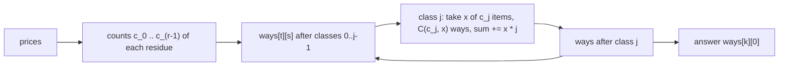

# AMPPZ 2017 J - Jesienne porządki

> [!info] Karta zadania
> - Treść: `201X/2017/J/J.pdf` ([PDF na GitHubie](../../../201X/2017/J/J.pdf)); pamięć 16 MB, limitu czasu treść nie
>   podaje.
> - Technika: plecak liczący sposoby po klasach reszt modulo r; dwumiany modulo liczba pierwsza 10⁶ + 3 (Dzień 6).
>   Trudność: 4 (11 z 44 drużyn).
> - Kod: [j-jesienne-porzadki.cpp](j-jesienne-porzadki.cpp). Złożoność: O(n + r² k²) czasu, O(r · k) pamięci.
> - Dzień kursu: [Dzień 10](../../dni/10-dp-1.md), ćwiczenie (pełna wersja, wyzwanie).

## Treść w skrócie

Jest n ≤ 10⁶ rzeczy o cenach a_i ≤ 10⁶. Handlarz kupi dokładnie k ≤ 3000 z nich, ale płaci tylko banknotami r ≤ 10
złotych, więc suma cen musi dzielić się przez r. Ile jest takich zbiorów k rzeczy? Wynik modulo 10⁶ + 3. Pamięć tylko
16 MB.

## Zanim przeczytasz dalej

50 minut. Przykład z treści: n = 5, k = 3, r = 4, ceny `8 1 2 2 3`, wynik 2 ({8, 1, 3} i {8, 2, 2}).

> [!tip]- Podpowiedź 1
> Dla podzielności przez r liczy się tylko a_i mod r. Ile informacji o rzeczach naprawdę potrzebujesz? Policz plecak
> "przedmiot po przedmiocie" w pamięci: n · k · r to ile operacji?

> [!tip]- Podpowiedź 2
> Rzeczy z tą samą resztą j są dla warunku nierozróżnialne. Wzięcie x z c rzeczy klasy j to C(c, x) sposobów i dokłada
> x · j do reszty sumy. Plecak po r klasach zamiast po n rzeczach.

## Droga myślenia

1. **Tylko reszty.** Suma dzieli się przez r wtedy, gdy suma reszt dzieli się przez r. Zamiast cen wystarczy r liczników
   c_0, ..., c_(r-1): ile rzeczy ma daną resztę. Ceny nie trzeba nawet zapamiętywać, co rozwiązuje problem 16 MB.
2. **Plecak po rzeczach jest za wolny.** ways[t][s] = liczba sposobów wybrania t rzeczy o sumie ≡ s; każda rzecz to
   przejście po wszystkich (t, s): n · k · r = 10⁶ · 3000 · 10 = 3 · 10¹⁰.
3. **Grupuj nierozróżnialne.** W klasie j z c rzeczami wybór x z nich daje C(c, x) zbiorów i przesuwa resztę o x · j
   mod r. Przejście po klasie: next[t + x][(s + x · j) mod r] += ways[t][s] · C(c, x) dla wszystkich x. Wynik to
   ways[k][0] po wszystkich klasach.
4. **Dwumiany modulo P = 10⁶ + 3.** P jest pierwsze, a c ≤ 10⁶ < P, więc żaden czynnik c(c - 1)...(c - x + 1) ani x!
   nie dzieli się przez P i wzór z odwrotnościami działa: C(c, x) = C(c, x - 1) · (c - x + 1) · x⁻¹. Odwrotności
   x ≤ k z małego twierdzenia Fermata (Dzień 6).
5. **Czas.** Na klasę (k + 1) · (k + 1) / 2 par (t, x), każda po r resztach: razem około r² k² / 2 = 4,5 · 10⁸
   mnożeń przy r = 10. Sztuczka: iloczyny są mniejsze niż P² ≈ 10¹², więc sumę 3001 iloczynów trzyma się w
   `unsigned long long` (do 3 · 10¹⁵) i resztę z dzielenia bierze raz na komórkę zamiast przy każdym dodawaniu.



Jak czytać diagram: ceny zamieniają się w r liczników już przy wczytywaniu, a potem pętla idzie po klasach, nie po
rzeczach. Jeden obrót pętli to plecak, w którym "przedmiotem" jest cała klasa z wyborem, ile jej elementów wziąć.

Przykład: reszty mod 4 cen `8 1 2 2 3` to 0, 1, 2, 2, 3, czyli c = (1, 1, 2, 1). Trzy rzeczy z sumą reszt ≡ 0: (0, 1, 3)
na 1 · 1 · 1 sposób i (0, 2, 2) na 1 · C(2, 2) = 1 sposób; razem 2.

## Rozwiązanie

```cpp
for (int j = 0; j < r; j++) {
    long long c = cnt[j];
    if (c == 0) continue;
    int top = (int)min<long long>(c, k);
    b[0] = 1;                              // b[x] = C(c, x) mod P
    for (int x = 1; x <= top; x++) b[x] = b[x - 1] * ((c - x + 1) % P) % P * inv[x] % P;
    for (int t = 0; t <= k; t++) {
        unsigned long long acc[10] = {0};  // sums below 3001 * P^2 < 2^64, reduce once
        int sh = 0;
        for (int x = 0; x <= min(t, top); x++) {
            const unsigned long long* row = &ways[(t - x) * r];
            for (int s = 0; s < r; s++) {
                int to = s + sh < r ? s + sh : s + sh - r;
                acc[to] += b[x] * row[s];
            }
            sh += j; if (sh >= r) sh -= r;  // shift = x * j mod r
        }
        for (int s = 0; s < r; s++) next[t * r + s] = acc[s] % P;
    }
    swap(ways, next);
}
```

Pełny program: [j-jesienne-porzadki.cpp](j-jesienne-porzadki.cpp) (wczytywanie kawałkami po 64 KB przez `fread`,
bez tablicy cen).

## Złożoność i optymalność

- O(n) na wczytanie i O(r² k²) na plecak po klasach; pamięć O(r · k), czyli dwie tablice po 30 010 liczb.
- Omówienie jury (AMPPZ 2017, UWr) ma tę samą tablicę DP[a][i][j] po klasach reszt i ten sam koszt O(k² r²). Dalej
  jury zauważa, że przejście po klasie to mnożenie wielomianów dwóch zmiennych, więc z FFT wychodzi
  O(k r² log(kr)), a sprytniej nawet mnożenie wielomianów stopnia O(k). FFT jest poza zakresem kursu; przy k = 3000
  wersja kwadratowa z sumowaniem bez reszt mieści się w 0,7 s (niżej), więc na zawodach to wystarcza.
- Liczba drużyn z akceptacją z rankingu 2017: 11 z 44.

## Pułapki

- **Plecak po rzeczach:** poprawny, ale 3 · 10¹⁰ kroków; tu wygrywa grupowanie nierozróżnialnych rzeczy.
- **Pamięć 16 MB:** tablica n × k nie istnieje, tablica cen (4 MB) zbędna; liczniki reszt wystarczą.
- **Moduł 10⁶ + 3, nie 10⁹ + 7:** iloczyn dwóch reszt to do 10¹², więc i tak `long long`.
- **k > n:** wynik 0; dwumian C(c, x) dla x > c to 0, a pętla do min(c, k) nie wychodzi poza zakres.
- **Reszta z dzielenia przy każdym dodawaniu:** poprawna, ale kilka razy wolniejsza od jednego `% P` na komórkę.

## Weryfikacja

- Kompilacja `g++ -std=c++17 -O2 -Wall -Wextra` bez ostrzeżeń, przykład z treści daje 2.
- 1500 małych wejść (n do 14, k od 1 do n + 1, r od 1 do 10, ceny 1..30) porównanych z brute force, który przegląda
  wszystkie podzbiory k-elementowe, i 300 średnich (n od 50 do 300, k do n, ceny do 10⁶) porównanych z plecakiem
  "przedmiot po przedmiocie" modulo 10⁶ + 3, czyli inną metodą, która sprawdza też dwumiany i reszty z dzielenia
  przy dużych liczbach sposobów. Wszystkie zgodne.
- Testy maksymalne, n = 10⁶, k = 3000, losowe ceny: r = 10 0,69 s, r = 7 0,35 s, r = 1 0,06 s. Dla r = 1 i dla
  wszystkich cen równych 10 przy r = 10 wynik to C(10⁶, 3000) mod (10⁶ + 3) = 504489, zgodnie z `math.comb` w Pythonie.
- Pamięć: szczytowy zestaw roboczy procesu przy n = 10⁶ (próbkowany co 5 ms) 4,9 MB przy limicie 16 MB.

## Wspólny mianownik

**Przedmioty nierozróżnialne dla warunku: zlicz klasy i licz dwumianem.** Gdy warunek zależy tylko od reszty, koloru
albo typu, plecak idzie po klasach, a wybór x elementów klasy daje C(c, x) sposobów. Tak samo przy ograniczonej
liczbie sztuk tego samego przedmiotu.
