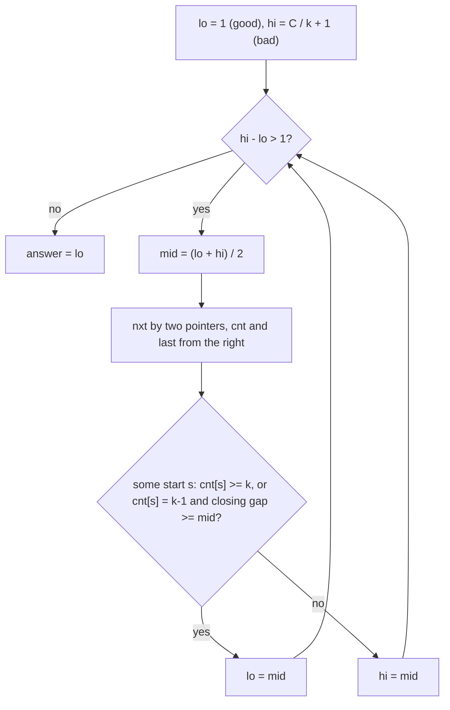

# AMPPZ 2017 L - Leśny kemping

> [!info] Karta zadania
> - Treść: `201X/2017/L/L.pdf` ([PDF na GitHubie](../../../201X/2017/L/L.pdf)); pamięć 64 MB, limitu czasu treść nie
>   podaje.
> - Technika: wyszukiwanie binarne po wyniku, zachłanne skoki, dwa wskaźniki, rozcięcie okręgu. Trudność: 3/5
>   (rozwiązało 19 z 44 drużyn).
> - Kod: [l-lesny-kemping.cpp](l-lesny-kemping.cpp). Złożoność: O(n log C), C to obwód.
> - Dzień kursu: [Dzień 5](../../dni/05-wyszukiwanie-binarne.md), zadanie omówione.

## Treść w skrócie

Na okręgu stoi n domków (n ≤ 5 · 10⁵), odległości między kolejnymi domkami po obwodzie to a₁, ..., aₙ (do 10⁹, ostatnia
to odległość od domku n do domku 1). Trzeba wybrać k domków (2 ≤ k ≤ n) tak, żeby najmniejsza odległość po obwodzie
między dwoma wybranymi domkami była jak największa. Wypisz tę największą możliwą najmniejszą odległość.

## Zanim przeczytasz dalej

30 minut. Przykład: n = 5, k = 3, odległości 1, 2, 5, 4, 3, odpowiedź 4 (domki 2, 4 i 5, przerwy 7, 4, 4). Zadaj sobie
pytanie, które łatwiej rozstrzygnąć: "jaka jest największa najmniejsza odległość?" czy "czy da się wybrać k domków
o przerwach co najmniej d?".

> [!tip]- Podpowiedź 1
> Jeśli da się wybrać k domków z przerwami co najmniej d, to tym bardziej z przerwami co najmniej d - 1. Odpowiedź
> "tak" i "nie" dzielą więc liczby d na dwa kawałki: wyszukiwanie binarne po d. Zostaje sprawdzenie dla ustalonego d.

> [!tip]- Podpowiedź 2
> Na odcinku (nie na okręgu) wystarcza zachłanność: bierz pierwszy domek, potem zawsze najbliższy domek w odległości
> co najmniej d. Na okręgu zgadnij domek o najmniejszym numerze w rozwiązaniu i rozetnij tam okrąg. Skoki "do
> najbliższego domku w odległości ≥ d" liczysz dla wszystkich domków naraz dwoma wskaźnikami.

## Droga myślenia

1. **Odwróć pytanie.** "Największe minimum" to sygnał wyszukiwania binarnego po wyniku. Funkcja good(d) = "da się
   wybrać k domków, w których każde dwie sąsiednie wybrane są co najmniej d od siebie" jest monotoniczna: prawdziwa dla
   małych d, fałszywa dla dużych. Szukamy ostatniego d, dla którego jest prawdziwa.
2. **Odległość po obwodzie to przerwy.** Wybrane domki dzielą okrąg na k przerw o sumie C (obwód). Najmniejsza
   odległość między dwoma wybranymi to najmniejsza przerwa, bo ona nie przekracza C / k ≤ C / 2. Stąd też górna
   granica wyniku: C / k.
3. **Sprawdzenie na odcinku.** Gdyby domki stały na odcinku, a pierwszy wybrany był ustalony, wystarcza zachłanność:
   zawsze bierz najbliższy domek w odległości co najmniej d. Każdy inny wybór daje na i-tym miejscu domek nie bliżej
   początku niż zachłanny (indukcja), więc zachłanność mieści najwięcej domków i kończy jak najwcześniej.
4. **Rozcięcie okręgu.** Niech s będzie wybranym domkiem o najmniejszym numerze. Pozostałe wybrane leżą za nim, na
   odcinku s..n, a jedyna przerwa, która przechodzi przez miejsce rozcięcia, to przerwa od ostatniego wybranego z powrotem
   do s: C - (pozycja ostatniego - pozycja s). Dla s wystarcza więc zachłanność na odcinku i jeden warunek na koniec.
5. **Wszystkie s naraz w O(n).** nxt[i] = pierwszy domek za i w odległości co najmniej d (dwa wskaźniki, bo nxt rośnie
   razem z i). Idąc od prawej, cnt[i] = liczba skoków z i do końca odcinka, last[i] = domek, na którym skoki się kończą.
   Dla startu s: jeśli cnt[s] ≥ k, to d jest dobre, bo k-ty skok mieści się przed końcem odcinka, więc przerwa
   zamykająca od (k-1)-ego wybranego jest dłuższa niż ten skok. Jeśli cnt[s] = k - 1, to ostatni wybrany to last[s]
   i sprawdzasz przerwę zamykającą. Jeśli cnt[s] < k - 1, z tego s się nie da.



Jak czytać diagram: zewnętrzna pętla to wyszukiwanie binarne po d z niezmiennikiem "lo jest dobre, hi jest złe".
Każde sprawdzenie to trzy przebiegi po tablicy: dwa wskaźniki dla nxt, jeden od prawej dla cnt i last, jeden po
startach s. Pętla kończy się, gdy lo i hi są sąsiednie; wtedy lo to największe dobre d.

Przykład: pozycje domków to 0, 1, 3, 8, 12, obwód 15, k = 3. Dla d = 4: nxt = 3, 3, 3, 4, brak (z domku 0 pierwszy
w odległości ≥ 4 to domek o pozycji 8). Start s = 1 (pozycja 1): skoki 1 → 8 → 12, cnt = 2 = k - 1, ostatni na pozycji
12, przerwa zamykająca 15 - (12 - 1) = 4 ≥ 4. Dobre. Dla d = 5 żaden start nie wystarcza, więc wynik 4.

## Rozwiązanie

```cpp
bool good(ll d) {
    for (int i = 0, j = 0; i < n; i++) {       // nxt[i]: first house at distance >= d
        if (j < i + 1) j = i + 1;
        while (j < n && p[j] - p[i] < d) j++;
        nxt[i] = j;
    }
    for (int i = n - 1; i >= 0; i--) {         // greedy jumps from i to the end of the path
        if (nxt[i] == n) { cnt[i] = 0; last[i] = i; }
        else { cnt[i] = cnt[nxt[i]] + 1; last[i] = last[nxt[i]]; }
    }
    for (int s = 0; s < n; s++) {              // s = chosen house with the smallest number
        if (cnt[s] >= k) return true;
        if (cnt[s] == k - 1 && C - (p[last[s]] - p[s]) >= d) return true;
    }
    return false;
}

ll lo = 1, hi = C / k + 1;                     // good(lo) holds, good(hi) fails
while (hi - lo > 1) {
    ll mid = lo + (hi - lo) / 2;
    if (good(mid)) lo = mid; else hi = mid;
}
```

Pełny program: [l-lesny-kemping.cpp](l-lesny-kemping.cpp).

## Złożoność i optymalność

- Jedno sprawdzenie to O(n): każdy z dwóch wskaźników przechodzi tablicę raz, pozostałe przebiegi są proste.
  Wyszukiwanie binarne robi log₂(C / k) ≤ 49 sprawdzeń (C ≤ 5 · 10¹⁴), razem O(n log C). Pamięć O(n).
- Omówienie jury (AMPPZ 2017) prowadzi tą samą drogą: wyszukiwanie binarne po d, skoki dwoma wskaźnikami, liczba skoków
  liczona od prawej i zgadywanie pierwszego wybranego domku. Sprawdzenie nie może być szybsze niż O(n), bo musi
  przeczytać wszystkie odległości; szybszego rozwiązania omówienie nie podaje.
- Skoki potęgowe (po 2^j skoków naraz) też dałyby sprawdzenie, ale O(n log k) na jedno d, a tablica 2n · 20 liczb nie
  mieści się w 64 MB. Liczenie cnt i last od prawej jest i szybsze, i lżejsze.

## Pułapki

- **Start tylko od pierwszego domku.** Pozycje 0, 1, 4, 7, obwód 9, k = 3: z domku 0 zachłanność bierze 0, 4, 7
  i przerwa zamykająca to 2, więc wynik wyszedłby 2. Poprawnie 3 (domki 1, 4, 7). Na okręgu trzeba sprawdzić każdy
  start albo udowodnić, że wystarczy kilka.
- **Przepełnienie:** obwód sięga 5 · 10⁵ · 10⁹ = 5 · 10¹⁴, więc pozycje, d i granice w `long long`.
- **Niezmiennik wyszukiwania binarnego:** lo = 1 jest zawsze dobre (domki stoją w różnych punktach, bo aᵢ ≥ 1),
  hi = C / k + 1 zawsze złe. Pętla `while (hi - lo > 1)` z takimi granicami nie zapętla się i nie gubi wyniku.
- **Odległość po obwodzie** to krótszy z dwóch łuków. Przy k ≥ 2 najmniejsza przerwa nie przekracza C / 2, więc
  wystarczy patrzeć na przerwy między sąsiednimi wybranymi.

## Weryfikacja

- Kompilacja `g++ -std=c++17 -O2 -Wall -Wextra` bez ostrzeżeń, przykład z treści poprawny (4).
- 1500 testów losowych (n od 2 do 10, odległości do 1, do 3, do 10 albo do 10⁹), porównanych z brute force, który
  przegląda wszystkie k-elementowe podzbiory domków i liczy najmniejszą odległość po obwodzie dla każdej pary.
  Wszystkie zgodne.
- Testy maksymalne: n = 5 · 10⁵, odległości do 10⁹, k = 2, n / 2 i n, oraz wszystkie odległości 10⁹: do 0,3 s.

## Wspólny mianownik

**"Największe minimum" i "najmniejsze maksimum" to wyszukiwanie binarne po wyniku.** Pytanie optymalizacyjne zamieniasz
na pytanie tak/nie "czy da się z progiem d?", które zwykle rozstrzyga zachłanność. Ten sam szkielet to CSES Factory
Machines (najmniejszy czas), CSES Array Division (najmniejsza największa suma) i klasyczne "agresywne krowy" na
odcinku. Okrąg dokłada jeden ruch: zgadnij pierwszy wybrany element i rozetnij tam okrąg.
