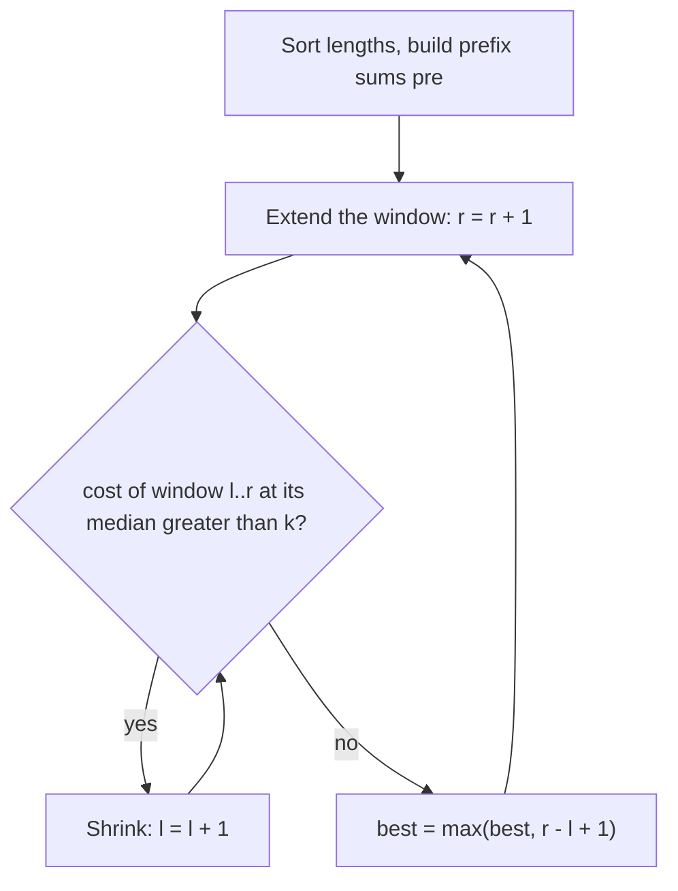

# AMPPZ 2018 J - Jednakowe szaliki

> [!info] Karta zadania
> - Treść: `201X/2018/J/J.pdf` ([PDF na GitHubie](../../../201X/2018/J/J.pdf)); pamięć 256 MB, limitu czasu treść nie
>   podaje.
> - Technika: sortowanie, mediana, sumy prefiksowe, dwa wskaźniki. Trudność: 2/5 (rozwiązało 37 z 51 drużyn).
> - Kod: [j-jednakowe-szaliki.cpp](j-jednakowe-szaliki.cpp). Złożoność: O(n log n).
> - Dzień kursu: [Dzień 4](../../dni/04-prefiksy-dwa-wskazniki.md), zadanie omówione.

## Treść w skrócie

Jest n szalików (n ≤ 10⁵) o długościach aᵢ (do 10⁹ rzędów). Dodanie albo sprucie jednego rzędu zajmuje jedną chwilę,
a do powrotu kupca zostało k chwil (k ≤ 10⁹). Kupiec weźmie tylko szaliki równej długości. Ile najwięcej szalików
da się wyrównać do jednej długości w k chwilach?

## Zanim przeczytasz dalej

25 minut. Przykład: długości 1, 2, 3, 4, 4 i k = 6, odpowiedź 5. Gdybyś wiedział, które szaliki wyrównujesz, do jakiej
długości opłaca się je wyrównać?

> [!tip]- Podpowiedź 1
> Ustal docelową długość T. Które szaliki najtaniej doprowadzić do T? Narysuj długości na osi liczbowej.

> [!tip]- Podpowiedź 2
> Najtańsze do T są szaliki najbliższe T, więc po posortowaniu wybierasz spójny kawałek tablicy. Dla kawałka najlepszą
> długością jest jego mediana. Jak policzyć koszt kawałka w O(1)? I co się dzieje z kosztem, gdy kawałek rośnie?

## Droga myślenia

1. **Koszt jednego szalika.** Doprowadzenie szalika a do długości T kosztuje |a - T| chwil, niezależnie od tego, czy
   dodajesz, czy prujesz.
2. **Które szaliki?** Przy ustalonym T najtańsze są szaliki najbliższe T. Po posortowaniu długości najbliższe T tworzą
   spójny kawałek tablicy (okno). Zatem najlepszy zestaw s szalików to zawsze jakieś okno długości s.
3. **Do jakiej długości?** Dla okna weź T i przesuń je o 1 w prawo. Koszt rośnie o liczbę szalików ≤ T i maleje o liczbę
   szalików > T. Opłaca się więc przesuwać T w stronę, po której jest więcej szalików, aż po obu stronach będzie tyle
   samo: T to **mediana** okna (przy parzystej długości każda z dwóch środkowych wartości).
4. **Koszt okna w O(1).** Dla okna a[l..r] z medianą na pozycji md = (l + r) / 2:
   koszt = (a[md] · (md - l) - suma a[l..md-1]) + (suma a[md+1..r] - a[md] · (r - md)).
   Sumy kawałków dają sumy prefiksowe: suma a[x..y] = pre[y + 1] - pre[x].
5. **Które okno?** Okno, które się wydłuża, nigdy nie tanieje (mediana nowego okna nie jest lepsza dla starych
   szalików niż ich własna mediana, a dochodzi jeszcze jeden szalik), a okno, które się skraca, nigdy nie drożeje.
   Dla każdego prawego końca r najdalszy w lewo dopuszczalny początek l tylko rośnie razem z r: dwa wskaźniki.



Jak czytać diagram: okno rośnie z prawej strony po jednym szaliku. Gdy jego koszt przekroczy k, ucinasz szaliki
z lewej, aż koszt znów się zmieści. Ponieważ koszt okna rośnie przy dokładaniu i maleje przy ucinaniu, żaden wskaźnik
nie musi się cofać, a każde sprawdzenie kosztu to O(1) dzięki sumom prefiksowym.

Przykład: 1, 2, 3, 4, 4 i k = 6. Całe okno ma medianę 3 i koszt 2 + 1 + 0 + 1 + 1 = 5 ≤ 6, więc odpowiedź 5. (Treść
wyrównuje do 2 za 6 chwil; mediana daje 5 chwil, ale wynik jest ten sam.)

## Rozwiązanie

```cpp
sort(a.begin(), a.end());
vector<ll> pre(n + 1, 0);                      // pre[i] = a[0] + ... + a[i - 1]
for (int i = 0; i < n; i++) pre[i + 1] = pre[i] + a[i];

auto cost = [&](int l, int r) {                // bring a[l..r] to the length of its median
    int md = (l + r) / 2;
    ll left = a[md] * (md - l) - (pre[md] - pre[l]);
    ll right = (pre[r + 1] - pre[md + 1]) - a[md] * (r - md);
    return left + right;
};

int best = 0, l = 0;
for (int r = 0; r < n; r++) {
    while (cost(l, r) > k) l++;                // a shorter window never costs more
    best = max(best, r - l + 1);
}
```

Pełny program: [j-jednakowe-szaliki.cpp](j-jednakowe-szaliki.cpp).

## Złożoność i optymalność

- Sortowanie O(n log n), sumy prefiksowe O(n), dwa wskaźniki O(n): każdy z l i r przesuwa się najwyżej n razy.
- Omówienie jury (AMPPZ 2018) ma te same obserwacje (spójne kawałki posortowanego ciągu, wyrównanie do mediany), ale
  wyszukuje binarnie wynik s i dla każdego s liczy koszty wszystkich okien długości s metodą gąsienicy, co daje
  O(n log n) po sortowaniu. Wersja z dwoma wskaźnikami jest po sortowaniu liniowa, więc lepsza o czynnik log n,
  choć przy n = 10⁵ to bez znaczenia. Sortowanie jest konieczne do ułożenia okien; całość działa 0,05 s.

## Pułapki

- **Przepełnienie:** koszt okna sięga 10⁵ · 10⁹ = 10¹⁴, a iloczyn a[md] · (md - l) też, więc `long long` w a, w pre
  i w koszcie.
- **Średnia zamiast mediany:** wyrównanie do średniej nie jest najtańsze (1, 1, 10: średnia 4 kosztuje 12, mediana 1
  kosztuje 9).
- **k = 0:** odpowiedź to największa liczba szalików tej samej długości; rozwiązanie robi to samo bez osobnego
  przypadku.
- **Indeksy sum prefiksowych:** pre ma n + 1 elementów, a suma a[x..y] to pre[y + 1] - pre[x]. Błąd o jeden daje zły
  koszt tylko w niektórych oknach, więc łatwo go przeoczyć na przykładzie.

## Weryfikacja

- Kompilacja `g++ -std=c++17 -O2 -Wall -Wextra` bez ostrzeżeń, przykład z treści poprawny (5).
- 1500 testów losowych (n od 1 do 9, długości do 4, do 15, do 60 albo do 10⁹, k od 0 do 10⁹), porównanych z brute
  force, który przegląda wszystkie podzbiory szalików i wszystkie długości docelowe (przy dużych długościach każdą
  długość z wejścia i jej sąsiadów). Wszystkie zgodne.
- Test maksymalny: n = 10⁵, długości do 10⁹, k = 10⁹: 0,05 s.

## Wspólny mianownik

**Najlepszy podzbiór to okno w posortowanej tablicy, a koszt okna to sumy prefiksowe.** Gdy koszt elementu zależy od
odległości od wspólnego celu, posortuj: wybrane elementy stoją obok siebie. Potem dwa wskaźniki po oknach i O(1) na
okno z sum prefiksowych. Ten sam ruch to CSES Stick Lengths (jedno okno, cała tablica) i wszystkie zadania typu
"zrównaj jak najwięcej w budżecie".
