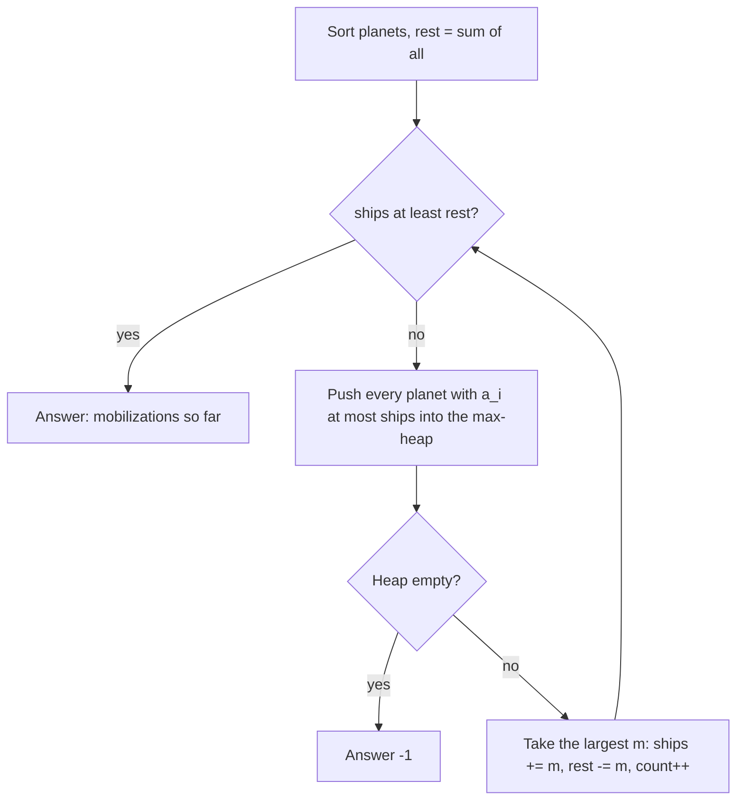

# AMPPZ 2019 A - Asymilacja

> [!info] Karta zadania
> - Treść: `201X/2019/A/A.pdf` ([PDF na GitHubie](../../../201X/2019/A/A.pdf)); limit czasu 1 s, pamięć 512 MB.
> - Technika: zachłanne "największy dostępny" z kolejką priorytetową, obserwacja o bilansie. Trudność: 2/5
>   (rozwiązały 34 z 46 drużyn).
> - Kod: [a-asymilacja.cpp](a-asymilacja.cpp). Złożoność: O(n log n) na zestaw.
> - Dzień kursu: [Dzień 3](../../dni/03-sortowanie-zachlanne.md), ćwiczenie (wyzwanie).

## Treść w skrócie

Jest n planet (n ≤ 2 · 10⁵, do 30 zestawów, suma n do 5 · 10⁵) z aᵢ mieszkańcami (do 10⁹) i k statków (do 10⁹).
Inwazja na planetę z m mieszkańcami wymaga s ≥ m statków; statki znikają, a planeta ma potem m + s mieszkańców.
Mobilizacja opanowanej planety (najwyżej raz na planetę) daje tyle statków, ilu ma ona mieszkańców. Ile najmniej
mobilizacji trzeba, żeby opanować wszystkie planety? Gdy się nie da, -1.

## Zanim przeczytasz dalej

40 minut. Najpierw policz: ile statków masz po inwazji na planetę m za pomocą s statków i od razu po jej mobilizacji?

> [!tip]- Podpowiedź 1
> Po inwazji i mobilizacji masz k - s + (m + s) = k + m statków. Liczba s w ogóle nie ma znaczenia, byle było Cię
> stać na s ≥ m. Mobilizacja planety m to więc zysk netto m statków.

> [!tip]- Podpowiedź 2
> Inwazja bez mobilizacji tylko zużywa statki, więc takie inwazje warto zostawić na koniec. Ile statków trzeba mieć
> na końcu? A którą planetę mobilizować jako pierwszą?

## Droga myślenia

1. **Bilans.** Inwazja s statkami i mobilizacja dają netto +m. Planety niezmobilizowane opanowujemy na końcu,
   każdą najmniejszą możliwą liczbą statków m, więc na końcu potrzeba tylu statków, ilu mieszkańców mają razem
   planety niezmobilizowane.
2. **Kolejność.** Najpierw same mobilizacje (każda zwiększa liczbę statków), potem inwazje bez mobilizacji. Stan to
   jedna liczba: statki K. Planetę m wolno zmobilizować, gdy m ≤ K. Koniec, gdy K ≥ suma niezmobilizowanych.
3. **Którą planetę?** Każda mobilizacja to +m statków i -m na liście do opanowania, więc im większa planeta, tym
   lepiej. Reguła: największa planeta, na którą Cię teraz stać.
4. **Dowód (argument zamiany).** Weź optymalny ciąg mobilizacji, który zgadza się z zachłannym na pierwszych t
   wyborach, a w kroku t + 1 bierze o zamiast zachłannego g (a_g ≥ a_o, g było dostępne).
   - Jeśli g jest w ciągu optymalnym później, zamień o i g miejscami: między tymi miejscami statków jest więcej o
     a_g - a_o, a liczba statków tylko rośnie w czasie, więc o nadal będzie dostępne na nowym miejscu; zbiór
     mobilizacji się nie zmienia.
   - Jeśli g nie ma w ciągu, wstaw g zamiast o: wszystkie późniejsze stany mają więcej statków, a warunek końca jest
     łatwiejszy.
   W obu przypadkach ciąg ma tyle samo mobilizacji i zgadza się z zachłannym na t + 1 wyborach.
5. **Implementacja.** Posortuj planety. Wskaźnik dorzuca do kopca maksimów każdą planetę, na którą już Cię stać;
   z kopca bierzesz największą. Pusty kopiec przed spełnieniem warunku końca oznacza -1.



Jak czytać diagram: liczba statków tylko rośnie, więc planety raz dostępne zostają dostępne, a wskaźnik po posortowanej
tablicy przechodzi każdą planetę raz. Kopiec trzyma dostępne, jeszcze niezmobilizowane planety i daje największą.

## Rozwiązanie

```cpp
sort(a.begin(), a.end());
priority_queue<ll> affordable;
int next = 0, mobilizations = 0;
bool ok = true;
while (ships < rest) {
    while (next < n && a[next] <= ships) affordable.push(a[next++]);
    if (affordable.empty()) { ok = false; break; }
    ll m = affordable.top();
    affordable.pop();
    ships += m;                            // pay m, get back 2m
    rest -= m;
    mobilizations++;
}
cout << (ok ? mobilizations : -1) << "\n";
```

Pełny program: [a-asymilacja.cpp](a-asymilacja.cpp).

## Złożoność i optymalność

- O(n log n) na zestaw: sortowanie i najwyżej n operacji na kopcu.
- Omówienie jury (slajdy AMPPZ 2019) prowadzi tym samym rozumowaniem: pierwszą mobilizowaną planetę można opanować
  i zmobilizować od razu, a wybrać trzeba największą dostępną. Jury proponuje `multiset` albo posortowaną tablicę;
  posortowana tablica z kopcem to ta druga, szybsza wersja.

## Pułapki

- **Warunek końca:** statki ≥ suma mieszkańców planet niezmobilizowanych, a nie statki ≥ największa planeta (inwazje
  zużywają statki).
- **Przepełnienie:** sumy do 2 · 10⁵ · 10⁹, więc `long long` dla statków i sumy.
- **Zero mobilizacji:** gdy k od razu pokrywa sumę, pętla się nie wykona i wynik to 0 (trzeci zestaw z przykładu).
- **Reguła "najmniejsza dostępna"** daje złe wyniki: kontrprzykład w Dniu 3 w polowaniu na kontrprzykłady.

## Weryfikacja

- Kompilacja `g++ -std=c++17 -O2 -Wall -Wextra` bez ostrzeżeń, przykład z treści poprawny (2, -1, 0, 4).
- 300 wejść po 25 zestawów (n od 1 do 4, mieszkańcy do 7, statki do 6), porównanych z brute force, który nie korzysta
  z żadnej obserwacji: przeszukuje wszerz wszystkie stany gry (statki, stan każdej planety), pozwala na inwazję
  dowolną liczbą statków s ≥ m i liczy mobilizacje jako koszt 1, a inwazje jako koszt 0. 7500 zestawów, wszystkie
  zgodne, co potwierdza też obserwację o bilansie.
- Test maksymalny: 3 zestawy po 166 666 planet, 0,22 s.

## Wspólny mianownik

**Największy dostępny element, gdy zasób rośnie.** Jeśli każdy wybór zwiększa zasób, a zasób decyduje o tym, co
jest dostępne, bierz największy dostępny element i trzymaj dostępne w kopcu. Wcześniej trzeba jednak zobaczyć, że
zadanie ma prosty bilans: tu obserwacja, że s nie ma znaczenia, zamienia grę z wieloma decyzjami w jedną liczbę.
