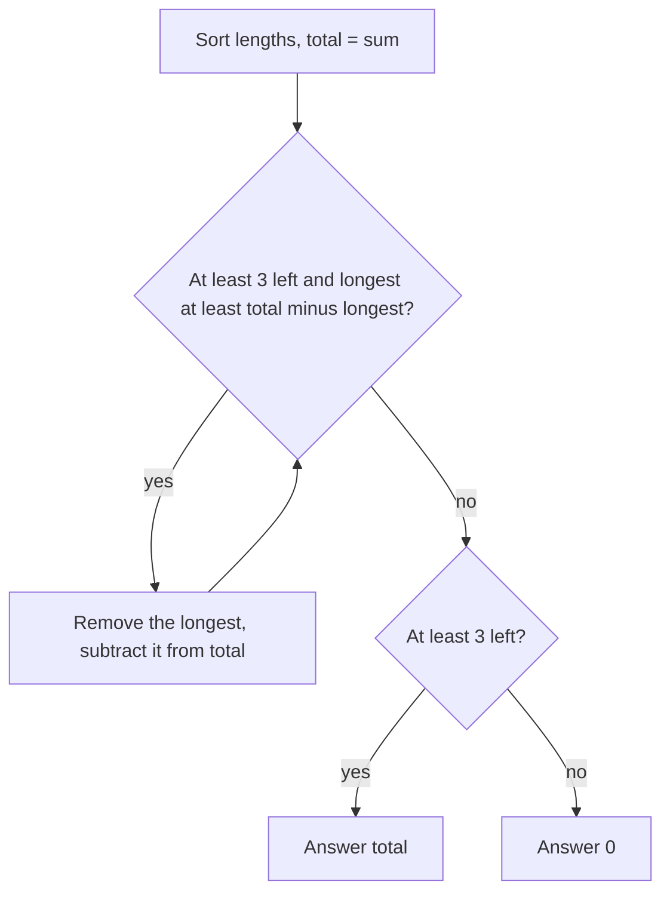

# AMPPZ 2019 C - Koło (z) Matematyków

> [!info] Karta zadania
> - Treść: `201X/2019/C/C.pdf` ([PDF na GitHubie](../../../201X/2019/C/C.pdf)); limit czasu 1 s, pamięć 512 MB.
> - Technika: sortowanie, usuwanie skrajnego elementu, nierówność wielokąta. Trudność: 1/5 (rozwiązały 42 z 46
>   drużyn; pierwsze zaakceptowane zadanie zawodów, 8. minuta).
> - Kod: [c-kolo-z-matematykow.cpp](c-kolo-z-matematykow.cpp). Złożoność: O(n log n) na zestaw.
> - Dzień kursu: [Dzień 3](../../dni/03-sortowanie-zachlanne.md), ćwiczenie.

## Treść w skrócie

Dane jest n odcinków (n ≤ 10⁵, długości do 10⁹; do 10⁵ zestawów, suma n do 10⁶). Wybierz niektóre z nich tak, żeby
dało się z nich ułożyć brzeg wielokąta wypukłego o niezerowym polu, i zmaksymalizuj obwód. Gdy się nie da, wypisz 0.

## Zanim przeczytasz dalej

20 minut. Kiedy z trzech odcinków da się zbudować trójkąt? A z czterech czworokąt?

> [!tip]- Podpowiedź 1
> Wielokąt o niezerowym polu z danych boków istnieje dokładnie wtedy, gdy boków jest co najmniej 3, a najdłuższy jest
> krótszy niż suma pozostałych. Wypukłość nic nie dokłada: takie boki zawsze da się ułożyć w wielokąt wypukły.

> [!tip]- Podpowiedź 2
> Jeśli najdłuższy odcinek nie spełnia warunku dla wszystkich odcinków, to czy może go spełnić w jakimkolwiek
> mniejszym zbiorze?

## Droga myślenia

1. **Warunek istnienia.** Najdłuższy bok L musi być krótszy niż suma pozostałych (ściśle, bo równość daje wielokąt
   zgnieciony do odcinka, o zerowym polu). Dla trójkąta to znana nierówność trójkąta.
2. **Jeśli warunek zachodzi dla wszystkich odcinków,** bierzemy wszystkie: dokładanie odcinków tylko zwiększa obwód.
3. **Jeśli nie zachodzi,** to L ≥ suma pozostałych. W każdym podzbiorze z L suma pozostałych jest jeszcze mniejsza,
   więc L nie może być w żadnym wielokącie. Usuwamy go i sprawdzamy następny najdłuższy.
4. **Algorytm:** posortuj, trzymaj sumę, usuwaj z końca, dopóki zostały co najmniej 3 odcinki, a ostatni nie jest
   krótszy niż suma reszty.



Jak czytać diagram: pętla zdejmuje z końca odcinki, które na pewno nie mogą być w żadnym rozwiązaniu. Gdy się
zatrzyma, albo zostało za mało odcinków, albo najdłuższy spełnia warunek i cały zbiór jest odpowiedzią.

## Rozwiązanie

```cpp
sort(len.begin(), len.end());
int cnt = n;
while (cnt >= 3 && len[cnt - 1] >= total - len[cnt - 1]) {
    total -= len[cnt - 1];
    cnt--;
}
cout << (cnt >= 3 ? total : 0) << "\n";
```

Pełny program: [c-kolo-z-matematykow.cpp](c-kolo-z-matematykow.cpp).

## Złożoność i optymalność

- O(n log n) na zestaw przez sortowanie, razem O(10⁶ log) dla sumy n.
- Omówienie jury (slajdy AMPPZ 2019): dokładnie ta pętla, "while max >= sum - max remove max".
- Można bez pełnego sortowania: kopiec maksimów (`priority_queue`) zdejmuje kolejne maksimum w O(log n), a zbudowanie
  go z tablicy kosztuje O(n). Usunięć bywa jednak do n, więc w najgorszym razie to nadal O(n log n). Wersja z `sort`
  jest najprostsza.

## Pułapki

- **Nierówność ścisła:** `>=` w warunku usuwania, bo przy równości pole jest zerowe (przykład 9, 5, 14 daje 0).
- **Przepełnienie:** suma do 10⁵ · 10⁹ = 10¹⁴, więc `long long`.
- **Mniej niż 3 odcinki:** odpowiedź 0, także gdy wszystkie odcinki są równe, ale są tylko dwa.
- **Wiele zestawów:** do 10⁵ zestawów, więc wszystko lokalne w pętli i bez czyszczenia tablic maksymalnego rozmiaru.

## Weryfikacja

- Kompilacja `g++ -std=c++17 -O2 -Wall -Wextra` bez ostrzeżeń, przykład z treści poprawny (21, 0, 15, 0).
- 300 wejść po 100 zestawów (n od 1 do 10, długości z zakresów do 3, 10, 30 albo do 10⁹), porównanych z brute force
  po wszystkich podzbiorach co najmniej trzech odcinków. 30 000 zestawów, wszystkie zgodne.
- Test maksymalny: 10 zestawów po 10⁵ odcinków, 0,33 s.

## Wspólny mianownik

**Usuń element, który na pewno nie może być w rozwiązaniu.** Skrajny element (tu najdłuższy), który łamie warunek
w najkorzystniejszej dla siebie sytuacji, łamie go zawsze, więc można go wyrzucić i powtórzyć. Ten sam ruch co
w [2014 A Adwokat](../2014/a-adwokat.md), tylko zamiast "skrajne elementy tworzą rozwiązanie" mamy "skrajny element
nie należy do żadnego rozwiązania".
