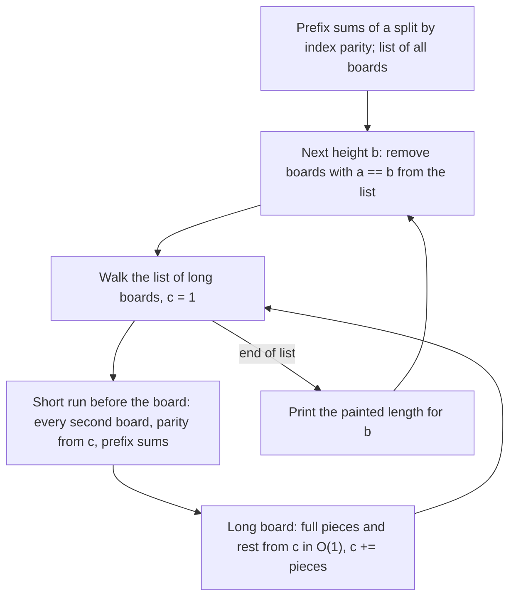

# AMPPZ 2021 F - Farba

> [!info] Karta zadania
> - Treść: `202X/2021/F/F.pdf` ([PDF na GitHubie](../../../202X/2021/F/F.pdf)); limit czasu 3 s, pamięć 1 GB.
> - Technika: sumy prefiksowe z podziałem na parzyste i nieparzyste indeksy, szacowanie harmoniczne (dla wysokości b
>   tylko deski dłuższe niż b są "ciekawe"), lista dwukierunkowa. Trudność: 3/5 (rozwiązało 18 z 45 drużyn).
> - Kod: [f-farba.cpp](f-farba.cpp). Złożoność: O(n + suma aᵢ) na zestaw.
> - Dzień kursu: [Dzień 4](../../dni/04-prefiksy-dwa-wskazniki.md), ćwiczenie (wyzwanie).

## Treść w skrócie

Jest n desek (n ≤ 10⁶) o długościach a₁, ..., aₙ, każda od 1 do 10⁶, a suma wszystkich długości to najwyżej 10⁶.
Dla wysokości płotu b każdą deskę po kolei tnie się na sztachety: odcina się kawałki długości b, dopóki reszta jest
dłuższa niż b, a resztę z przedziału [1, b] też przybija się jako sztachetę. Maluje się co drugą sztachetę, zaczynając
od pierwszej. Dla każdego b od 1 do M = max aᵢ wypisz łączną długość pomalowanych sztachet. Do 5 zestawów.

## Zanim przeczytasz dalej

45 minut. Najpierw policz, ile kosztuje symulacja wprost dla wszystkich b. Potem zastanów się, czym różnią się deski
krótsze od b od dłuższych.

> [!tip]- Podpowiedź 1
> Deska o długości a ≤ b daje dokładnie jedną sztachetę, całą deskę. Deska dłuższa niż b daje ⌈a / b⌉ sztachet, ale
> wynik dla niej da się policzyć w O(1), jeśli wiesz, czy jej pierwsza sztacheta jest pomalowana. Ile jest desek
> dłuższych niż b, łącznie po wszystkich b?

> [!tip]- Podpowiedź 2
> Desek dłuższych niż b jest najwyżej suma / b, a po wszystkich b łącznie najwyżej suma aᵢ. Między dwiema długimi
> deskami stoi ciąg krótkich, każda to jedna sztacheta, więc maluje się co drugą deskę z tego ciągu. Suma co drugiego
> elementu kawałka tablicy to sumy prefiksowe osobno dla parzystych i nieparzystych indeksów.

## Droga myślenia

1. **Symulacja wprost.** Dla jednego b sztachet jest Σ⌈aᵢ / b⌉ ≥ n. Po wszystkich b to co najmniej n · M, a przy jednej
   desce długości 500 000 i 500 000 desek długości 1 wychodzi 2,5 · 10¹¹. Za wolno.
2. **Deska długa, w O(1).** Deska a > b daje f = ⌊(a - 1) / b⌋ pełnych sztachet długości b i resztę a - f · b. Jeśli
   jej pierwsza sztacheta ma numer c, to pełne mają numery c, ..., c + f - 1, a reszta c + f. Pomalowane są numery
   nieparzyste, więc wśród pełnych jest ⌈f / 2⌉ pomalowanych, gdy c jest nieparzyste, albo ⌊f / 2⌋, gdy parzyste,
   a resztę malujemy, gdy c + f jest nieparzyste. Potrzebny jest tylko numer c.
3. **Ciąg desek krótkich.** Każda deska a ≤ b to jedna sztacheta, więc deski l..r dostają kolejne numery c, c + 1, ...
   Pomalowane są co druga: te o indeksie tej samej parzystości co l (gdy c nieparzyste) albo przeciwnej. Suma
   elementów o indeksie danej parzystości w kawałku l..r to **suma prefiksowa** policzona osobno dla parzystych
   i nieparzystych indeksów: O(1).
4. **Ile długich desek?** Deska a jest długa dla b = 1, ..., a - 1, czyli łącznie po wszystkich b daje a - 1 "wizyt".
   Suma po wszystkich deskach to najwyżej suma aᵢ ≤ 10⁶. Dla każdego b przechodzimy więc tylko po długich deskach
   (i po jednym kawałku krótkich między każdymi dwiema), co kosztuje O(liczba długich + 1).
5. **Lista długich desek w kolejności.** Gdy b rośnie, deski tylko przestają być długie (deska a odpada przy b = a).
   Lista dwukierunkowa po indeksach z usuwaniem w O(1) daje długie deski po kolei, a deski do usunięcia przy danym b
   zbieramy z góry w kubełkach według długości.



Jak czytać diagram: zewnętrzna pętla idzie po wysokościach b, wewnętrzna po długich deskach z listy. Kawałki krótkich
desek między długimi załatwia jedna różnica sum prefiksowych, a długą deskę jeden wzór; numer c następnej sztachety
mówi, które z nich są pomalowane.

Przykład: deski 10, 7, 2, 8 i b = 4. Długie są 10, 7 i 8, krótka 2. Deska 10: c = 1, f = 2 pełne (numery 1, 2, pomalowana
1), reszta 2 z numerem 3 (pomalowana): 4 + 2 = 6, c = 4. Deska 7: f = 1 (numer 4, nie), reszta 3 z numerem 5 (tak): 3,
c = 6. Krótka 2 dostaje numer 6 (nie), c = 7. Deska 8: f = 1 (numer 7, tak), reszta 4 z numerem 8 (nie): 4. Razem
6 + 3 + 4 = 13, zgodnie z treścią.

## Rozwiązanie

```cpp
for (int b = 1; b <= M; b++) {
    for (int i : byLen[b]) {                   // a[i] == b: from now on a short board
        nxt[prv[i]] = nxt[i];
        prv[nxt[i]] = prv[i];
    }
    ll paint = 0, cur = 1;                     // cur = number of the next picket, odd ones are white
    int last = 0;
    for (int i = nxt[0];; i = nxt[i]) {        // long boards in order, n + 1 is the end
        int l = last + 1, r = i - 1;           // short boards between two long ones
        if (l <= r) {
            int p = ((l + (cur % 2 == 1 ? 0 : 1)) % 2);
            paint += parSum(p, l, r);          // boards l..r with index parity p
            cur += r - l + 1;
        }
        if (i == n + 1) break;
        ll full = (a[i] - 1) / b;              // pickets of length b, then one rest in [1, b]
        paint += (cur % 2 == 1 ? (full + 1) / 2 : full / 2) * b;
        if ((cur + full) % 2 == 1) paint += a[i] - full * b;
        cur += full + 1;
        last = i;
    }
    out += to_string(paint) + '\n';
}
```

Pełny program: [f-farba.cpp](f-farba.cpp).

## Złożoność i optymalność

- Dla wysokości b praca to O(1 + liczba desek dłuższych niż b). Suma po b = 1..M to O(M + suma aᵢ), plus O(n) na sumy
  prefiksowe i listę. Razem O(n + suma aᵢ) na zestaw, czyli liniowo względem wejścia (M ≤ suma aᵢ), a samo wyjście ma
  M liczb. Lepiej się nie da.
- Omówienie jury (AMPPZ 2021): najpierw drzewo przedziałowe, w którym każdy węzeł trzyma liczbę elementów i sumy na
  pozycjach nieparzystych i parzystych, aktualizowane dla desek aᵢ ≥ b, w czasie O(suma aᵢ · log n); potem "da się
  szybciej": skompresowany ciąg, w którym sąsiednie deski, które już się nie zmieniają, łączy się w jeden przedział,
  z elementów najwyżej dwa razy więcej niż desek aᵢ ≥ b, w czasie O(suma aᵢ). Rozwiązanie powyżej to ta druga wersja:
  sumy prefiksowe po parzystości zastępują łączenie przedziałów. Statystyki: 66 zgłoszeń, 18 zaakceptowanych,
  pierwsze w 54. minucie.

## Pułapki

- **Ostatnia sztacheta:** reszta jest z przedziału [1, b], nie [0, b). Deska a = 2b daje dwie pełne sztachety, a nie
  dwie pełne i pustą; stąd f = ⌊(a - 1) / b⌋, a nie ⌊a / b⌋.
- **Granica "długa":** deska a = b jest krótka (jedna sztacheta). Usuwamy ją z listy na początku obrotu dla b = a.
- **Parzystość numerów:** pomalowana jest pierwsza sztacheta całego płotu, a nie każdej deski; numer c przechodzi
  przez wszystkie deski.
- **Wyjście:** do 10⁶ wierszy na zestaw, razem do 5 · 10⁶; składamy je w jednym `string`.

## Weryfikacja

- Kompilacja `g++ -std=c++17 -O2 -Wall -Wextra` bez ostrzeżeń, przykład z treści poprawny (14, 13, 15, 13, 15, 16,
  21, 23, 24, 12).
- 300 wejść losowych, każde z 1-20 zestawami (n od 1 do 8, długości do 1, do 3, do 8 albo do 20), porównanych z brute
  force, który dla każdego b tnie wszystkie deski wprost i sumuje co drugą sztachetę. Wszystkie zgodne.
- Test maksymalny: 5 zestawów po sumie 10⁶ (jedna deska 10⁶; deska 500 000 i 500 000 desek 1; 1000 desek po 1000;
  losowe do 2000; 10⁶ desek 1): razem 0,43 s, ok. 12 MB wyjścia.

## Wspólny mianownik

**Szacowanie harmoniczne: elementów większych niż b jest najwyżej suma / b.** Gdy dla każdego b od 1 do M robisz coś
z elementami "dużymi względem b", łączna praca to suma, a nie n · M. Resztę (elementy małe, które zachowują się
jednakowo) załatwiają sumy prefiksowe. Ten sam ruch wraca przy dzielnikach (dla każdego d przejdź po wielokrotnościach
d: M/1 + M/2 + ... = O(M log M), Dzień 6).
