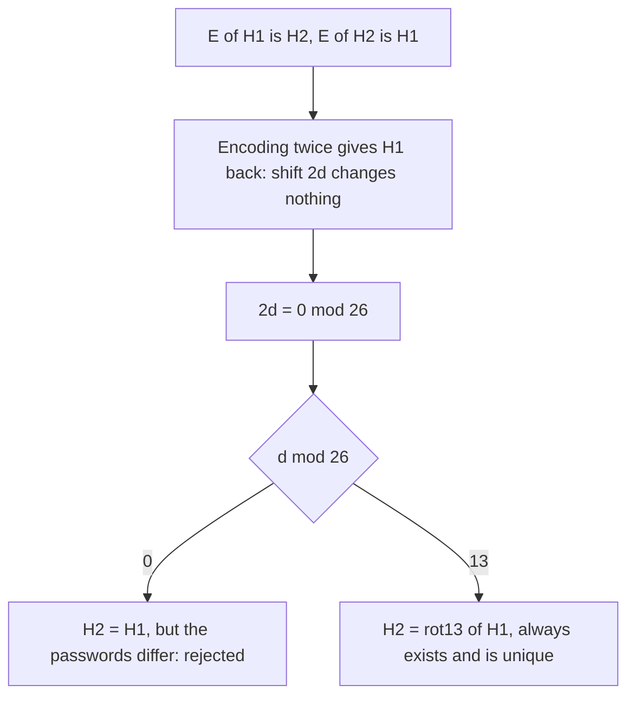

# AMPPZ 2021 H - Hasła

> [!info] Karta zadania
> - Treść: `202X/2021/H/H.pdf` ([PDF na GitHubie](../../../202X/2021/H/H.pdf)); limit czasu 5 s, pamięć 1 GB.
> - Technika: napisy, arytmetyka na znakach modulo 26; obserwacja zamiast rozpatrywania przypadków. Trudność: 1/5
>   (rozwiązały wszystkie 44 drużyny, pierwsza w 3. minucie).
> - Kod: [h-hasla.cpp](h-hasla.cpp). Złożoność: O(łączna długość haseł).
> - Dzień kursu: [Dzień 2](../../dni/02-stl-symulacja.md), ćwiczenie.

## Treść w skrócie

Bajtek ma dwa różne hasła. Zakodował oba szyfrem Cezara z tym samym przesunięciem d > 0 (każda litera przesuwa się
o d dalej w alfabecie a-z, za `z` wraca się do `a`) i okazało się, że zakodowane pierwsze hasło to drugie,
a zakodowane drugie to pierwsze. Dla danego pierwszego hasła wypisz drugie albo `NIE`, gdy nie da się go wyznaczyć
jednoznacznie. Do 20 haseł, każde do 200 000 liter, łącznie do 10⁶.

## Zanim przeczytasz dalej

15 minut. Nie pisz kodu, dopóki nie wiesz, kiedy odpowiedzią jest `NIE`.

> [!tip]- Podpowiedź 1
> Zakoduj pierwsze hasło dwa razy. Co wychodzi i o ile łącznie przesunęła się każda litera?

> [!tip]- Podpowiedź 2
> Przesunięcie o t zostawia literę na miejscu tylko wtedy, gdy t dzieli się przez 26. Jakie d spełniają
> 2d ≡ 0 (mod 26) i które z nich odpada, bo hasła są różne?

## Droga myślenia

1. **Zapis wzorem.** Niech E oznacza kodowanie z przesunięciem d. Wiemy: E(H1) = H2 i E(H2) = H1. Stąd
   E(E(H1)) = H1, a dwa kodowania z rzędu to jedno kodowanie z przesunięciem 2d.
2. **Kiedy przesunięcie nic nie zmienia.** Litera wraca na swoje miejsce tylko przy przesunięciu podzielnym przez 26.
   Hasło ma co najmniej jedną literę, więc 2d ≡ 0 (mod 26), czyli d ≡ 0 albo d ≡ 13 (mod 26).
3. **Odrzucenie d ≡ 0.** Wtedy H2 = H1, a hasła są różne. Zostaje d ≡ 13: drugie hasło to ROT13 pierwszego, zawsze
   istnieje i jest jedno. **Odpowiedź `NIE` nigdy nie występuje.**
4. **Kod:** każdą literę zamieniamy na `'a' + (ch - 'a' + 13) % 26`.



Jak czytać diagram: idziemy od faktu z treści do równania na d. Równanie ma dwa rozwiązania modulo 26; jedno odpada
przez warunek "hasła są różne", drugie daje odpowiedź dla każdego wejścia. Gałęzi z odpowiedzią `NIE` w diagramie
nie ma, bo nie ma jej w zadaniu.

## Rozwiązanie

```cpp
int z;
cin >> z;
while (z--) {
    string s;
    cin >> s;
    for (char& ch : s) ch = char('a' + (ch - 'a' + 13) % 26);   // rot13
    cout << s << "\n";                                           // the answer NIE never happens
}
```

Pełny program: [h-hasla.cpp](h-hasla.cpp). `ch - 'a'` to numer litery od 0 do 25, `+ 13` przesuwa, `% 26` zawija
za `z`, a `'a' + ...` zamienia numer z powrotem na literę.

## Złożoność i optymalność

O(L), gdzie L to łączna długość haseł: każdą literę czytamy, zmieniamy i wypisujemy raz. Lepiej się nie da, bo
trzeba wypisać L liter.

## Pułapki

- **Szukanie przypadków `NIE`.** Treść sugeruje, że takie są. Na zawodach było 59 zgłoszeń i 44 zaakceptowane, czyli
  15 błędnych na zadaniu, które rozwiązały wszystkie drużyny (oficjalne statystyki).
- **Brak `% 26`:** litery od `n` w górę wyszłyby poza alfabet.
- **Wczytywanie:** `cin >> s` czyta jedno słowo; hasła nie mają spacji, więc to wystarczy.

## Weryfikacja

- Kompilacja bez ostrzeżeń, przykład z treści (`password` daje `cnffjbeq`) poprawny.
- 563 losowe hasła (także jednoliterowe i z alfabetów `a`, `az`, `nm`) i 5 haseł po 200 000 liter porównane
  z rozwiązaniem siłowym, które próbuje każdego d od 1 do 26 i sprawdza oba warunki z treści. Rozwiązanie siłowe ani
  razu nie dało `NIE`.
- Porównanie z omówieniem: oficjalne slajdy AMPPZ 2021
  (https://amppz.tcs.uj.edu.pl/2021/data/amppz2021-slajdy.pdf) prowadzą tym samym rozumowaniem do d = 13. Na stronie
  zawodów są też oficjalne testy i rozwiązania wzorcowe: https://amppz.tcs.uj.edu.pl/2021/data.html.

## Wspólny mianownik

**Zanim obsłużysz przypadek "nie da się", sprawdź, czy on w ogóle istnieje.** Zapisz warunki wzorem (tu: złożenie
dwóch operacji) i uprość. Autorzy często zostawiają w treści wyjście `NIE`, żeby nie zdradzić obserwacji.
