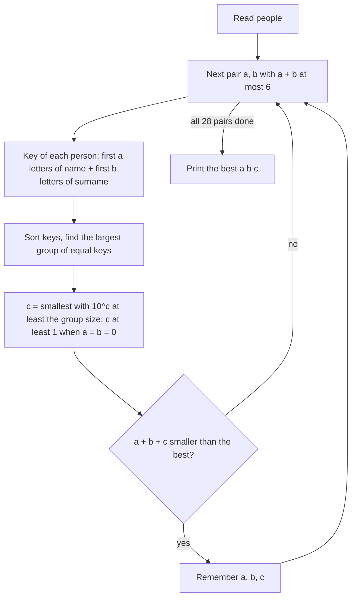

# AMPPZ 2022 A - Aliasy

> [!info] Karta zadania
> - Treść: `202X/2022/A/A.pdf` ([PDF na GitHubie](../../../202X/2022/A/A.pdf)); limit czasu 40 s, pamięć 1 GB.
> - Technika: obserwacja z limitów (ograniczenie odpowiedzi z góry), grupowanie przez sortowanie (STL). Trudność:
>   2/5 (rozwiązały 32 z 50 drużyn).
> - Kod: [a-aliasy.cpp](a-aliasy.cpp). Złożoność: O(28 · n log n) na zestaw.
> - Dzień kursu: [Dzień 2](../../dni/02-stl-symulacja.md), pełna wersja.

## Treść w skrócie

n zawodników (do 200 000; w zestawie łącznie do 1,5 mln liter imion i nazwisk), imię i nazwisko z małych liter.
Alias to a pierwszych liter imienia (wszystkie, gdy imię jest krótsze), potem b pierwszych liter nazwiska, potem
c wybranych cyfr. Znajdź a, b, c ≥ 0, nie wszystkie równe zero, przy których da się nadać wszystkim różne aliasy,
z najmniejszą sumą a + b + c (dowolne, gdy jest kilka). Dwie osoby mogą mieć identyczne imię i nazwisko. Do 6
zestawów danych.

## Zanim przeczytasz dalej

25 minut. Zacznij od pytania: jaki jest najgorszy możliwy wynik?

> [!tip]- Podpowiedź 1
> Ustal a i b. Osoby z tą samą częścią literową aliasu trzeba rozróżnić cyframi. Ile różnych końcówek daje c cyfr?

> [!tip]- Podpowiedź 2
> Weź a = b = 0. Ile cyfr wystarczy zawsze, skoro osób jest najwyżej 200 000? Co to mówi o tym, jakie a i b w ogóle
> warto sprawdzać?

> [!tip]- Podpowiedź 3
> Przy a = b = 2 osoba "a bc" i osoba "ab c" dostają tę samą część literową `abc`. Co dokładnie trzeba porównywać?

## Droga myślenia

1. **Ustalone a i b.** Część literowa aliasu to prefiks imienia doklejony do prefiksu nazwiska. Osoby o różnych
   częściach literowych nigdy się nie zderzą: cyfr jest zawsze dokładnie c i stoją na końcu, a litera to nie cyfra.
   Osoby o tej samej części literowej rozróżniamy cyframi: c cyfr daje 10^c końcówek. Najmniejsze dobre c spełnia
   10^c ≥ rozmiar największej grupy.
2. **Ograniczenie wyniku z góry.** a = b = 0 i c = 6 daje 10⁶ końcówek, a osób jest najwyżej 200 000. To zawsze
   działa, więc wynik to najwyżej 6. Zatem sprawdzamy tylko pary z a + b ≤ 6: jest ich 28. To cała trudność zadania:
   bez tej obserwacji a i b wydają się sięgać długości imion, a z nią zostaje kilka pętli.
3. **Pułapka doklejania.** Liczy się cały napis aliasu, a nie para (prefiks imienia, prefiks nazwiska). Przy a = b = 2
   osoba "a bc" dostaje `abc` i osoba "ab c" też `abc`, choć pary prefiksów są różne.
4. **Grupowanie.** Dla każdej pary (a, b) liczymy klucz każdej osoby, sortujemy klucze i szukamy najdłuższego ciągu
   równych (można też `unordered_map`). Klucz trzymamy jako liczbę w systemie o podstawie 27 (litera to cyfra od 1
   do 26): napis ma najwyżej 6 liter, a 27⁶ < 4 · 10⁸. Cyfry od 1, a nie od 0, sprawiają, że napisy różnej długości
   dają różne liczby.
5. **Brzegi.** a = b = 0 daje pustą część literową, więc wtedy c ≥ 1 (alias nie może być pusty). Dwie identyczne osoby
   zawsze wymuszają c ≥ 1.



Jak czytać diagram: zewnętrzna pętla przechodzi 28 par (a, b), bo większe sumy nie mogą pobić wyniku 6. Dla każdej
pary jedno sortowanie mówi, ile cyfr trzeba; zapamiętujemy najtańszą trójkę.

## Rozwiązanie

```cpp
for (int a = 0; a <= 6; a++)
    for (int b = 0; a + b <= 6; b++) {
        // the letter part of the alias as a number in base 27 (letters are digits 1..26)
        for (int i = 0; i < n; i++) {
            ll key = 0;
            for (int j = 0; j < a && j < (int)first[i].size(); j++) key = key * 27 + (first[i][j] - 'a' + 1);
            for (int j = 0; j < b && j < (int)last[i].size(); j++) key = key * 27 + (last[i][j] - 'a' + 1);
            keys[i] = key;
        }
        // largest group of people with the same letter part
        sort(keys.begin(), keys.end());
        int largest = 0;
        for (int i = 0, j = 0; i < n; i = j) {
            while (j < n && keys[j] == keys[i]) j++;
            largest = max(largest, j - i);
        }
        // c digits give 10^c different endings; the alias must not be empty
        int c = 0;
        ll endings = 1;
        while (endings < largest) endings *= 10, c++;
        if (a + b == 0) c = max(c, 1);
        if (a + b + c < bestSum) bestSum = a + b + c, ba = a, bb = b, bc = c;
    }
```

Pełny program: [a-aliasy.cpp](a-aliasy.cpp). Na przykładzie z treści wypisuje `0 0 2` zamiast `1 1 0`: obie trójki
mają sumę 2 i obie są poprawne (11 osób mieści się w 100 dwucyfrowych końcówkach), a treść pozwala wypisać dowolną.

## Złożoność i optymalność

- 28 par, a dla każdej budowa kluczy O(6n) i sortowanie O(n log n): razem O(28 · n log n) na zestaw. Dla
  n = 200 000 to ok. 10⁸ prostych operacji; zmierzony najgorszy przypadek (6 zestawów po 200 000 osób) to 2,1 s przy
  limicie 40 s, razem z przesłaniem danych.
- Z `unordered_map` zamiast sortowania wychodzi O(28 · n) średnio. Lepiej niż liniowo się nie da, bo trzeba wczytać
  wszystkie imiona; stała 28 bierze się z ograniczenia wyniku przez 6.

## Pułapki

- **Doklejanie** (krok 3): grupuj po całym napisie, nie po parze prefiksów.
- **Identyczne osoby:** grupa zawsze ma co najmniej 2 osoby, więc c ≥ 1.
- **Pusty alias** przy a = b = 0: wymuś c ≥ 1.
- **Potęgi dziesięciu** licz na liczbach całkowitych (`endings *= 10`), nie przez `pow`, które działa na `double`.
- **Krótkie imiona:** pętla `j < a && j < size` bierze wszystkie litery, gdy imię jest krótsze; `s.substr(0, a)`
  zrobiłoby to samo.

## Weryfikacja

- Kompilacja bez ostrzeżeń; przykład z treści daje poprawną odpowiedź o tej samej sumie.
- 867 losowych zestawów porównanych z rozwiązaniem siłowym, które próbuje każde a do najdłuższego imienia + 1, każde
  b do najdłuższego nazwiska + 1 i c do 6, licząc prawdziwe napisy aliasów w słowniku; sprawdzane było, że wypisana
  trójka jest poprawna i ma najmniejszą sumę. Małe alfabety (`a`, `ab`) wymuszają zderzenia przez doklejanie
  i powtórzone osoby.
- Najgorszy przypadek: 6 zestawów po 200 000 osób, 2,1 s.
- Porównanie ze źródłami: oficjalnego omówienia AMPPZ 2022 nie znalazłem (strona zawodów nie ma slajdów), rozwiązań
  z sieci też nie. W rankingu zadanie rozwiązały 32 z 50 drużyn. Optymalność: argument z wczytywania wyżej.

## Wspólny mianownik

**Ogranicz odpowiedź prostym rozwiązaniem.** Jeśli jakieś proste rozwiązanie zawsze działa i kosztuje X, to optimum
szukasz tylko wśród rozwiązań tańszych od X. Tu z "a i b do półtora miliona" robi się 28 przypadków. Drugi wzorzec:
**grupuj po tym, co naprawdę ma być różne** (cały napis aliasu), a nie po jego składowych.
