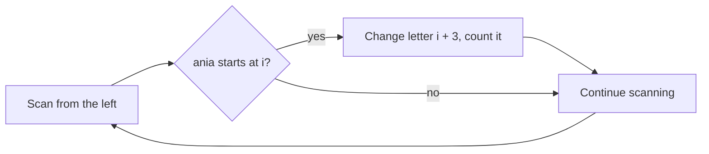

# AMPPZ 2022 C - Ctrl+C Ctrl+V

> [!info] Karta zadania
> - Treść: `202X/2022/C/C.pdf` ([PDF na GitHubie](../../../202X/2022/C/C.pdf)); limit czasu 5 s, pamięć 1 GB.
> - Technika: zachłanne skanowanie od lewej (przebicie przedziałów), napisy. Trudność: 1/5 (rozwiązało 49 z 50
>   drużyn).
> - Kod: [c-ctrl-c-ctrl-v.cpp](c-ctrl-c-ctrl-v.cpp). Złożoność: O(długość słowa).
> - Dzień kursu: [Dzień 3](../../dni/03-sortowanie-zachlanne.md), ćwiczenie.

## Treść w skrócie

Słowo z małych liter angielskich (długość do 10⁶, do 10 000 słów, łącznie do 5 · 10⁶ liter). Ile najmniej liter trzeba
zmienić, żeby w słowie nie było spójnego fragmentu `ania`?

## Zanim przeczytasz dalej

15 minut. W Dniu 2 był przypadek brzegowy `aniania`. Jaka jest dla niego odpowiedź i dlaczego?

> [!tip]- Podpowiedź 1
> Każde wystąpienie `ania` to przedział czterech pozycji. Zmiana jednej litery niszczy wszystkie wystąpienia, które
> ją zawierają. Których wystąpień może dotyczyć jedna zmiana?

> [!tip]- Podpowiedź 2
> Idź od lewej. Przy pierwszym znalezionym wystąpieniu musisz zmienić którąś z jego czterech liter. Która z nich
> pomoże najbardziej wystąpieniom, które są dalej?

## Droga myślenia

1. **Model.** Wystąpienie zaczynające się w i to przedział [i, i + 3]. Szukamy najmniejszego zbioru pozycji, który
   trafia w każdy przedział (zmieniamy litery na tych pozycjach). Zmiana na literę spoza `a`, `n`, `i` nie tworzy
   nowego wystąpienia, więc liczy się tylko trafienie w istniejące.
2. **Zachłanna reguła.** Najbardziej na lewo leżący przedział musi być trafiony. Ze wszystkich jego pozycji
   najdalej w prawo sięga ostatnia, i3, więc trafia ona w każdy przedział, w który trafiłaby inna pozycja tego
   przedziału, i może jeszcze w kolejne. Zmieniamy ją i idziemy dalej.
3. **Dowód (argument zamiany).** Weź dowolny optymalny zbiór zmian. Jego zmiana w pierwszym przedziale leży na pozycji
   p ≤ i + 3. Wszystkie przedziały zawierające p zaczynają się nie wcześniej niż i, więc zawierają też i + 3.
   Przesunięcie zmiany z p na i + 3 niczego nie psuje. Dalej indukcja po kolejnych przedziałach.
4. **Jak wystąpienia mogą się nakładać?** Tylko o jedną literę (`ania` zaczyna się i kończy na `a`), czyli przesunięte
   o 3. Zmiana ostatniego `a` niszczy oba wystąpienia w `aniania`, więc odpowiedź to 1, a nie 2.



Jak czytać diagram: przebieg od lewej do prawej, a zmiana litery dzieje się w samym słowie. Dzięki temu wystąpienie,
które zaczynało się na zmienionej literze, po prostu przestaje być znajdowane.

## Rozwiązanie

```cpp
int changes = 0;
for (int i = 0; i + 4 <= (int)s.size(); i++) {
    if (s.compare(i, 4, "ania") == 0) {
        s[i + 3] = '#';                    // '#' is in no occurrence, so nothing new appears
        changes++;
    }
}
```

Pełny program: [c-ctrl-c-ctrl-v.cpp](c-ctrl-c-ctrl-v.cpp).

## Złożoność i optymalność

- O(l) na słowo, razem O(5 · 10⁶). Optymalne, bo każdą literę trzeba przeczytać.
- Oficjalnego omówienia AMPPZ 2022 nie ma (organizatorzy nie opublikowali slajdów). Poprawność pokazuje dowód wyżej
  i test z brute force.

## Pułapki

- **Liczenie wystąpień zamiast zmian:** `aniania` ma dwa wystąpienia, a wystarcza jedna zmiana.
- **Zmiana złej litery:** zmiana pierwszego `a` nie niszczy wystąpienia, które zaczyna się na ostatnim `a`.
- **Wiele zestawów:** licznik zerujesz w każdym zestawie (tu jest deklarowany w środku pętli).
- **Wejście:** 5 · 10⁶ znaków, szybkie `cin` z szablonu wystarcza.

## Weryfikacja

- Kompilacja `g++ -std=c++17 -O2 -Wall -Wextra` bez ostrzeżeń, przykład z treści poprawny (1, 2, 0).
- 300 wejść po 60 słów długości do 9, sklejanych z kawałków `ania`, `ani`, `nia`, `an` i pojedynczych liter, żeby
  powstawały łańcuchy nakładających się wystąpień. Brute force przegląda wszystkie słowa tej samej długości nad
  alfabetem {a, n, i, x} (pozostałe litery zachowują się jak x), odrzuca te z `ania` i bierze najmniejszą liczbę
  różnic względem danego słowa. 18 000 słów, wszystkie zgodne.
- Test maksymalny: 5 słów po 10⁶ liter, 0,14 s.

## Wspólny mianownik

**Przebicie przedziałów.** "Najmniej zmian, żeby nigdzie nie było wzorca" to szukanie najmniejszego zbioru punktów
trafiających w każdy przedział (wystąpienie). Reguła: prawy koniec pierwszego nietrafionego przedziału. Ten sam
schemat działa dla dowolnych przedziałów po posortowaniu po prawym końcu.
