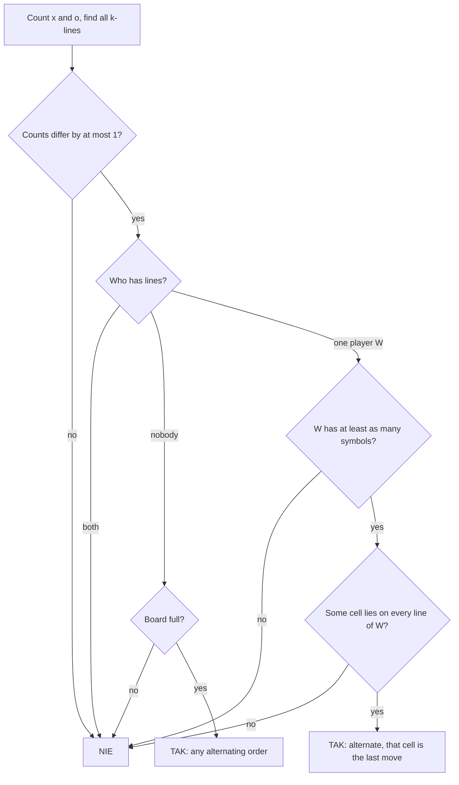

# AMPPZ 2022 K - Kółko i Krzyżyk

> [!info] Karta zadania
> - Treść: `202X/2022/K/K.pdf` ([PDF na GitHubie](../../../202X/2022/K/K.pdf)); limit czasu 6 s, pamięć 1 GB.
> - Technika: implementacja, warunki konieczne i wystarczające, przypadki brzegowe; konstrukcja kolejności ruchów.
>   Trudność: 3/5 (rozwiązało 27 z 50 drużyn).
> - Kod: [k-kolko-i-krzyzyk.cpp](k-kolko-i-krzyzyk.cpp). Złożoność: O(n² · k) na planszę.
> - Dzień kursu: [Dzień 2](../../dni/02-stl-symulacja.md), pełna wersja (wyzwanie).

## Treść w skrócie

Uogólnione kółko i krzyżyk na planszy n × n (3 ≤ n ≤ 6). Gracze na zmianę stawiają swój znak na pustym polu,
zaczynać może każdy z nich. Kto po swoim ruchu ma k (2 ≤ k ≤ n) swoich znaków z rzędu poziomo, pionowo albo po
skosie w jedną z dwóch stron, wygrywa i gra się kończy; pełna plansza bez wygranej to remis. Dla danej planszy
rozstrzygnij, czy może być stanem końcowym poprawnej gry, a jeśli tak, wypisz kolejność wypełniania pól. Do 10 000
plansz w teście.

## Zanim przeczytasz dalej

40 minut. Przykład ma siedem plansz, w tym cztery z odpowiedzią `NIE`, i każda z nich pokazuje inny powód. Wypisz te
powody, zanim zaczniesz myśleć o kodzie.

> [!tip]- Podpowiedź 1
> Powody z przykładu: jeden gracz ma za dużo znaków; wygrał gracz, który nie mógł wykonać ostatniego ruchu; gra nie
> jest skończona; gra skończyłaby się wcześniej. Zapisz każdy jako warunek, który da się sprawdzić na planszy.

> [!tip]- Podpowiedź 2
> Ostatni ruch zwycięzcy domknął wszystkie jego linie naraz. Co to mówi o polu ostatniego ruchu?

> [!tip]- Podpowiedź 3
> Jeśli takie pole istnieje, czy kolejność pozostałych ruchów ma jakiekolwiek znaczenie?

## Droga myślenia

1. **Liczby znaków.** Gracze grają na zmianę, więc liczby krzyżyków i kółek różnią się najwyżej o 1.
2. **Linie obu graczy naraz** to `NIE`: gra skończyłaby się na pierwszej z nich.
3. **Nikt nie ma linii.** Gra mogła skończyć się tylko remisem, więc plansza musi być pełna. Wtedy dobra jest każda
   naprzemienna kolejność: znaków się nie zdejmuje, więc skoro na końcu nie ma linii, to nie było jej nigdy. Zaczyna
   gracz, który ma więcej znaków (przy równej liczbie dowolny).
4. **Linie ma jeden gracz W.** Wygrał ostatnim ruchem, więc ma co najmniej tyle znaków co przeciwnik. Przed ostatnim
   ruchem nie miał żadnej linii, więc pole ostatniego ruchu leży na **każdej** jego linii. Takiego pola może nie być
   (dwie rozłączne linie, jak w czwartej planszy przykładu przy k = 2), i wtedy `NIE`.
5. **Te warunki wystarczają.** Gdy wspólne pole c istnieje, postaw wszystkie pozostałe znaki w dowolnej naprzemiennej
   kolejności, a c na końcu. Przed c żadna linia W nie istnieje (każda zawiera c), a przeciwnik nie ma linii wcale.
   Zaczyna W, gdy ma o jeden znak więcej, a przeciwnik, gdy liczby są równe; w obu przypadkach ostatni ruch wypada
   na W.
6. **Implementacja.** Linia długości k zaczyna się w każdym polu w jednym z 4 kierunków (w prawo, w dół, skos w prawo
   w dół, skos w lewo w dół): sprawdzamy, czy mieści się na planszy i czy wszystkie jej pola mają ten sam znak. Pole
   c: dla każdego pola liczymy, na ilu liniach W leży; pasuje pole, którego licznik równa się liczbie linii.



Jak czytać diagram: każda strzałka do `NIE` to jeden warunek konieczny i jeden powód z przykładu. Do `TAK` prowadzą
dwie drogi (remis i wygrana), a na każdej odpowiedź da się zbudować wprost, co jest dowodem, że warunki wystarczają.

## Rozwiązanie

```cpp
int first = -1;
pair<int, int> lastCell = {-1, -1};
int winner = segX.empty() ? (segO.empty() ? -1 : 1) : (segO.empty() ? 0 : 2);

if (abs(cx - co) <= 1 && winner != 2) {
    if (winner == -1) {
        // draw: the board must be full, any order is fine
        if (cx + co == n * n) first = cx >= co ? 0 : 1;
    } else {
        int w = winner, l = 1 - winner;
        auto& seg = (w == 0) ? segX : segO;
        // the winner made the last move, so he has at least as many symbols
        if ((int)cells[w].size() >= (int)cells[l].size()) {
            // the last cell must lie on every winning segment
            map<pair<int, int>, int> onSeg;
            for (auto& s : seg)
                for (auto p : s) onSeg[p]++;
            for (auto [p, cnt] : onSeg)
                if (cnt == (int)seg.size()) lastCell = p;
            if (lastCell.first != -1) first = cells[w].size() > cells[l].size() ? w : l;
        }
    }
}
```

Pełny program: [k-kolko-i-krzyzyk.cpp](k-kolko-i-krzyzyk.cpp). Funkcja `segments` zbiera wszystkie linie długości k
danego znaku, a na końcu program przestawia pole `lastCell` na koniec listy zwycięzcy i wypisuje pola na zmianę,
zaczynając od gracza `first`. Na przykładzie wypisuje inne kolejności niż w treści, ale poprawne.

## Złożoność i optymalność

Linii do sprawdzenia jest najwyżej 4n², każda ma k pól: O(n² · k) na planszę, dla 10 000 plansz 6 × 6 ok. 10⁷
operacji. Asymptotycznie da się O(n²) (długości serii w każdym kierunku zamiast sprawdzania każdej linii osobno),
ale przy k ≤ n ≤ 6 to różnica stałej najwyżej 6, a wypisanie odpowiedzi i tak kosztuje n².

## Pułapki

- **Seria dłuższa niż k:** k + 1 znaków z rzędu to dwie linie długości k; pole ostatniego ruchu musi leżeć na obu
  (pole w środku serii działa, skrajne nie).
- **Przeciwprzekątna** (skos w lewo w dół) łatwo umyka; druga plansza przykładu wygrywa właśnie tak.
- **Zaczynać może każdy:** przy równej liczbie znaków zwycięzca nie zaczynał.
- **Wygrana na pełnej planszy:** ostatni ruch może naraz wygrać i zapełnić planszę; to wygrana, nie remis.
- **Pusta plansza:** nie jest pełna i nikt nie wygrał, więc `NIE`.
- **Wiele plansz w teście:** listy pól i planszę zakładaj od nowa dla każdej planszy.

## Weryfikacja

- Kompilacja bez ostrzeżeń; werdykty wszystkich siedmiu plansz przykładu zgodne.
- Rozwiązanie siłowe: przeszukanie wszystkich gier od pustej planszy (n ≤ 4, każde k) zaznacza każdą osiągalną
  planszę końcową.
- Wszystkie 3⁹ = 19 683 plansze 3 × 3 dla k = 2 i k = 3 (39 366 przypadków, 3636 z odpowiedzią `TAK`) oraz 9000
  plansz 4 × 4 (z prawdziwych losowych gier, z jednym zmienionym polem i całkiem losowych): werdykty zgodne
  z rozwiązaniem siłowym.
- 8000 plansz 5 × 5 i 6 × 6: z prawdziwych losowych gier (muszą dostać `TAK`) i z jednym zmienionym polem.
- Każda wypisana kolejność ruchów sprawdzona osobno odtworzeniem gry: ruchy na zmianę, żadnej wygranej przed
  ostatnim ruchem, gra kończy się wygraną albo pełną planszą.
- Porównanie ze źródłami: omówienia AMPPZ 2022 nie znalazłem (strona zawodów nie ma slajdów), w rankingu zadanie
  rozwiązało 27 z 50 drużyn. Poprawność wynika z warunków koniecznych (kroki 1-4) i konstrukcji (krok 5), sprawdzonej
  wyczerpująco dla n = 3 i siłowo dla n = 4.

## Wspólny mianownik

**Zadanie odwrotne: czy ten stan jest osiągalny?** Zbierz warunki konieczne (co musi być prawdą o każdym stanie
końcowym), a potem pokaż, że razem wystarczają, budując przykład. Przypadki brzegowe wychodzą same: każdy warunek to
jeden powód odpowiedzi `NIE`, a przykład z treści zwykle pokazuje je po kolei.
