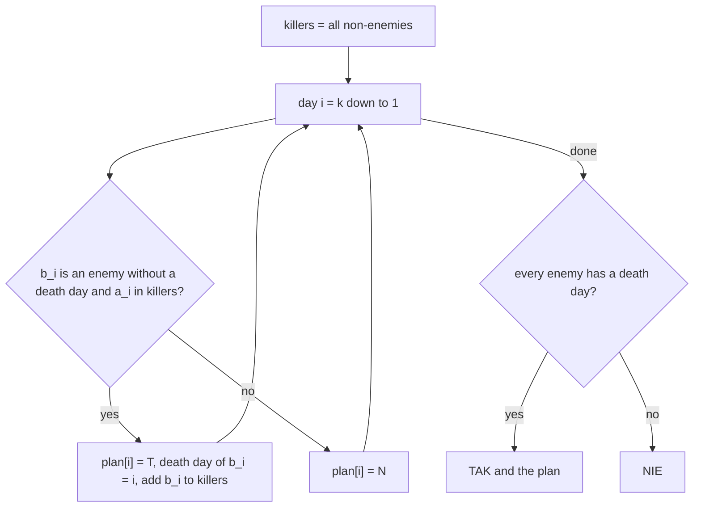

# AMPPZ 2022 M - Mniejsze zło

> [!info] Karta zadania
> - Treść: `202X/2022/M/M.pdf` ([PDF na GitHubie](../../../202X/2022/M/M.pdf)); limit czasu 15 s, pamięć 1 GB.
> - Technika: grafy i zachłanne: osiągalność w czasie, przejście po dniach od ostatniego, każdy wróg ginie
>   najpóźniej, jak się da. Trudność: 2 (rozwiązało 30 z 50 drużyn).
> - Kod: [m-mniejsze-zlo.cpp](m-mniejsze-zlo.cpp). Złożoność: O(n + k) na zestaw.
> - Dzień kursu: [Dzień 8](../../dni/08-grafy-1.md), ćwiczenie (pełna wersja).

## Treść w skrócie

Przez k dni (k ≤ 10⁶) Gebajt spotyka parę (aᵢ, bᵢ) z n osób i zabija bᵢ, jeśli obaj jeszcze żyją, chyba że tego dnia
rzucisz urok (wtedy nic się nie dzieje). Dana jest lista s wrogów. Czy da się tak wybrać dni z urokiem, żeby wszyscy
wrogowie zginęli? Wypisz TAK i plan (T: pozwól zabić, N: urok) albo NIE. Do 1000 zestawów, sumy n i k do 4 · 10⁶.

## Zanim przeczytasz dalej

35 minut. Przykład 1: 6 dni, wrogowie 1, 2, 3; odpowiedź TAK, np. NTTTNT. Przykład 2: trzy osoby, dni (1, 2)
i (2, 3), wrogowie 2 i 3: NIE. Zanim zaczniesz, odpowiedz sobie: czy kiedykolwiek opłaca się, żeby zginął ktoś, kto nie jest
wrogiem?

> [!tip]- Podpowiedź 1
> Nie-wrogów nigdy nie warto zabijać: żywy nie-wróg nikomu nie przeszkadza, a może jeszcze zabić wroga. Więc nie-wrogowie
> żyją zawsze. Kto może zabić wroga w dniu i?

> [!tip]- Podpowiedź 2
> Wróg zabity w dniu d może sam zabijać tylko w dniach przed d. Im później zginie, tym dłużej jest użyteczny. Przejdź po
> dniach od ostatniego do pierwszego.

## Droga myślenia

1. **Nie-wrogowie zawsze żyją.** Zabicie nie-wroga tylko odbiera potencjalnego zabójcę; spotkania, w których ofiarą
   byłby nie-wróg, blokujemy urokiem.
2. **Warunek dla wroga.** Wróg e ginie w jakimś dniu d(e), w którym b = e, a zabójca a jeszcze żyje: a jest nie-wrogiem
   albo wrogiem, który zginie później, d(a) > d(e). Łańcuch zabójców ma więc rosnące dni i kończy się na nie-wrogu: to
   ścieżka w grafie "kto kogo może zabić", ale tylko z krawędziami w dobrej kolejności czasu.
3. **Od końca.** Idziemy po dniach od k do 1 i trzymamy zbiór osób, które "żyją od tego dnia do końca planu jako
   zabójcy": na początku nie-wrogowie. W dniu i, jeśli bᵢ to wróg jeszcze bez dnia śmierci, a aᵢ jest w zbiorze, to
   ustalamy d(bᵢ) = i i dodajemy bᵢ do zbioru (we wszystkich wcześniejszych dniach jeszcze żyje).
4. **Dlaczego najpóźniej.** Wróg zabity w dniu i jest zabójcą we wszystkich dniach przed i. Późniejszy dzień śmierci
   daje nadzbiór dni, w których jest użyteczny, więc zachłanne "najpóźniej, jak się da" nigdy nie przegrywa
   z innym planem (indukcja od końca: zbiór zachłanny w każdym dniu zawiera zbiór dowolnego poprawnego planu).
5. **Odpowiedź:** TAK, gdy każdy wróg dostał dzień; plan ma T dokładnie w dniach d(e). Pierwszy wróg bez dnia oznacza NIE.
   Gdy wrogami są wszyscy (s = n), zbiór startowy jest pusty i odpowiedź to NIE: ktoś musi przeżyć, żeby zabić ostatniego.



Jak czytać diagram: "killers" w chwili przetwarzania dnia i to osoby, które na pewno żyją w dniu i: nie-wrogowie
i wrogowie, którzy zginą dopiero później. Dodanie bᵢ do zbioru w dniu i działa dla wszystkich dni przed i, które
przetwarzamy potem.

Przykład 2: wrogowie {2, 3}, zabójcy na starcie {1}. Dzień 2 (2, 3): 2 nie jest zabójcą, bo jeszcze nie wiemy, czy
dożyje dnia 2. Dzień 1 (1, 2): 1 jest zabójcą, więc 2 ginie w dniu 1. Wróg 3 nie ma dnia śmierci: NIE. I słusznie: 3
może zginąć tylko z ręki 2 w dniu 2, a 2 może zginąć tylko w dniu 1.

## Rozwiązanie

```cpp
vector<char> enemy(n + 1, 0), killed(n + 1, 0), alive(n + 1, 1);
for (int j = 0; j < s; j++) { int v; cin >> v; enemy[v] = 1; alive[v] = 0; }
string plan(k, 'N');
int left = s;
for (int i = k - 1; i >= 0; i--)
    if (enemy[b[i]] && !killed[b[i]] && alive[a[i]]) {
        plan[i] = 'T';                         // the latest possible day for b[i]
        killed[b[i]] = 1;
        alive[b[i]] = 1;                       // before day i b[i] is alive and can kill
        left--;
    }
if (left == 0) cout << "TAK\n" << plan << "\n";
else cout << "NIE\n";
```

Pełny program: [m-mniejsze-zlo.cpp](m-mniejsze-zlo.cpp). Dla przykładu 1 daje NTNTNT, które treść też podaje jako
poprawne.

## Złożoność i optymalność

- O(n + k) na zestaw, razem O(Σn + Σk) = O(8 · 10⁶); tyle kosztuje samo wczytanie, więc szybciej się nie da.
- Omówienia jury dla 2022 nie ma (slajdów brak na stronie UJ), rozwiązań w sieci nie znalazłem. Optymalność planu
  uzasadnia punkt 4 (zbiór zachłanny jest nadzbiorem zbioru każdego poprawnego planu w każdym dniu), a poprawność
  potwierdza test z brute force niżej.

## Pułapki

- **Przejście od pierwszego dnia** (zabijaj, kiedy się da) zabija wrogów za wcześnie i odbiera ich jako zabójców:
  w przykładzie 1 plan "same T" zabija 2 w dniu 1 i nic więcej się nie dzieje.
- **Pary powtarzają się, także odwrócone:** nic nie zakładaj o kolejności (aᵢ, bᵢ); każdy dzień rozpatruj osobno.
- **s = n:** odpowiedź NIE, algorytm daje ją sam, bez osobnego przypadku.
- **Wejście do 8 · 10⁶ liczb:** szybkie wczytywanie (`cin` bez synchronizacji wystarcza, limit to 15 s).

## Weryfikacja

- Kompilacja `g++ -std=c++17 -O2 -Wall -Wextra` bez ostrzeżeń, przykłady z treści poprawne (TAK z planem NTNTNT, NIE).
- 1500 wejść losowych po 5 zestawów (n ≤ 5, k ≤ 10), razem 7500 zestawów, sprawdzonych programem, który przegląda
  wszystkie 2ᵏ planów symulacją wprost z treści (czy odpowiedź TAK/NIE się zgadza) i symuluje plan wypisany przez
  rozwiązanie (czy wszyscy wrogowie giną). Wszystkie zgodne, 2890 razy TAK.
- Testy maksymalne (sumy n i k po 4 · 10⁶): cztery zestawy losowe n = k = 10⁶ 1,09 s, cztery łańcuchy (wróg i ginie
  z ręki i + 1, odpowiedź TAK) 1,60 s.

## Wspólny mianownik

**Gdy zdarzenia mają kolejność w czasie, a użyteczność obiektu kończy się w chwili jakiegoś zdarzenia, przejdź po czasie
od końca i odsuwaj to zdarzenie najpóźniej, jak się da.** Ten sam ruch to "przetwarzaj od końca, usuwanie zamień na
dodawanie" (Find-Union wstecz, Dzień 9) i zachłanne terminy "najpóźniej możliwy" (2012 J Jutro z Dnia 3, tylko od
drugiej strony).
