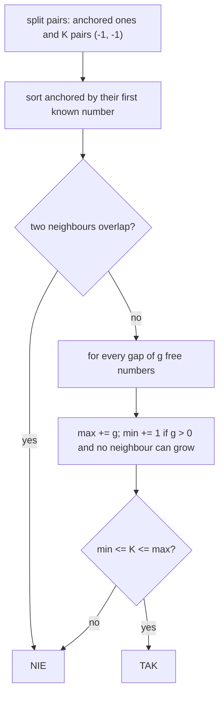

# AMPPZ 2023 B - Missing Boundaries

> [!info] Karta zadania
> - Treść: `202X/2023/B/B.pdf` ([PDF na GitHubie](../../../202X/2023/B/B.pdf)), po angielsku; czas 4 s, pamięć 1024 MB.
> - Technika: sortowanie i zachłanne: znane końce posortowane, przerwy między nimi i suma przedziałów
>   [minimum, maksimum]. Trudność: ~3 (rankingu 2023 brak; szacunek z treści).
> - Kod: [b-missing-boundaries.cpp](b-missing-boundaries.cpp). Złożoność: O(N log N) na test.
> - Dzień kursu: [Dzień 9](../../dni/09-grafy-2.md), zadanie bez etykiety (technika z
>   [Dnia 3](../../dni/03-sortowanie-zachlanne.md)).

## Treść w skrócie

Przedział liczb całkowitych [1, L] (L ≤ 10⁹) podzielono na N niepustych, rozłącznych przedziałów [a_i, b_i], które
razem go pokrywają, a potem część końców zastąpiono przez -1. Dostajesz N par (a_i, b_i) w dowolnej kolejności. Czy
da się uzupełnić brakujące końce tak, żeby znów był to podział [1, L]? TAK albo NIE. Do 30 000 testów, suma N do 2 · 10⁵.

## Zanim przeczytasz dalej

30 minut. Przykłady: L = 51 i pary (1, -1), (11, 50), (-1, -1), (-1, 10) dają TAK (np. [1, 7], [8, 10], [11, 50], [51, 51]);
L = 2 i trzy pary (-1, -1) dają NIE (trzy niepuste przedziały nie mieszczą się w dwóch liczbach); L = 3 i pary (1, 2),
(2, 3) dają NIE (liczba 2 dwa razy).

> [!tip]- Podpowiedź 1
> Przedział z co najmniej jednym znanym końcem na pewno zajmuje tę liczbę. Ustaw takie przedziały w kolejności znanych
> liczb. Co musi się stać z liczbami między nimi?

> [!tip]- Podpowiedź 2
> Przedział (a, -1) może rosnąć w prawo, (-1, b) w lewo, (a, b) wcale. Przerwę g wolnych liczb wypełniają rosnący sąsiedzi
> i przedziały (-1, -1). Ile przedziałów (-1, -1) najmniej, a ile najwięcej zmieści się w jednej przerwie?

## Droga myślenia

1. **Co jest pewne.** Para (a, b) zajmuje dokładnie [a, b]; (a, -1) zajmuje a i może się wydłużyć w prawo; (-1, b) zajmuje
   b i może się wydłużyć w lewo; K par (-1, -1) to przedziały bez żadnej kotwicy.
2. **Sortowanie.** Przedziały z kotwicą posortowane po pierwszej znanej liczbie nie mogą na siebie zachodzić; jeśli
   zachodzą, odpowiedź to NIE. Wystarczy porównywać sąsiadów w posortowanej kolejności.
3. **Przerwy.** Między kolejnymi kotwicami (i przed pierwszą, i za ostatnią) zostaje przerwa g wolnych liczb. Jeśli sąsiad
   z lewej to (a, -1) albo sąsiad z prawej to (-1, b), przerwa mieści od 0 do g przedziałów (-1, -1): resztę wchłonie
   rosnący sąsiad. Jeśli żaden sąsiad nie może rosnąć, przerwa potrzebuje od 1 do g przedziałów. Przerwa g = 0 mieści 0.
4. **Zbieranie.** Każda przerwa przyjmuje dowolną liczbę z przedziału [min, max], niezależnie od innych, więc wszystkie
   razem przyjmą dowolne K z [Σ min, Σ max]. Odpowiedź: TAK, gdy nie ma zachodzenia i Σ min ≤ K ≤ Σ max.



Jak czytać diagram: zachodzenie kotwic to jedyny powód odpowiedzi NIE poza liczeniem; potem każda przerwa dokłada swój
przedział możliwych liczb przedziałów (-1, -1), a K musi trafić w sumę tych przedziałów.

Przykład 1: kotwice (1, -1) zajmuje 1, (-1, 10) zajmuje 10, (11, 50) zajmuje 11-50. Przerwy: 2-9 (g = 8, sąsiad z lewej
rośnie): [0, 8]; między 10 a 11: g = 0; 51 (g = 1, za ostatnią kotwicą, (11, 50) nie rośnie): [1, 1]. Suma [1, 9], K = 1:
TAK.

## Rozwiązanie

```cpp
sort(items.begin(), items.end());          // (left, right, kind): 0 both known, 1 = [a, -1], 2 = [-1, b]
bool ok = true;
long long lo = 0, hi = 0, cur = 1;          // cur = first number not yet covered
int prevKind = -1;                          // -1 = left border of [1, L]
auto gap = [&](long long g, bool canGrow) {
    if (g <= 0) return;
    hi += g;                                // at most one hidden interval per number
    if (!canGrow) lo += 1;                  // somebody must cover the gap
};
for (auto [l, r, kind] : items) {
    if (l < cur) { ok = false; break; }     // overlaps the previous item
    gap(l - cur, prevKind == 1 || kind == 2);
    cur = r + 1;
    prevKind = kind;
}
if (ok) gap(L - cur + 1, prevKind == 1);
cout << (ok && lo <= K && K <= hi ? "TAK" : "NIE") << "\n";
```

Pełny program: [b-missing-boundaries.cpp](b-missing-boundaries.cpp).

## Złożoność i optymalność

- Sortowanie O(N log N) na test, reszta O(N); suma po testach O(Σ N log N). Pamięć O(N).
- Omówienia jury dla 2023 nie znalazłem (ani rozwiązań w sieci, zob. notatka o omówieniach w temacie). Rozwiązanie
  opiera się na dowodzie z punktów 3-4: przerwy są niezależne, bo każdy rosnący przedział rośnie tylko w jedną stronę,
  więc nie obsługuje dwóch przerw naraz. Wczytanie N par to Ω(N), a sortowanie znanych końców jest tu naturalnym
  kosztem.

## Pułapki

- **Kolejność na wejściu jest dowolna:** pary trzeba posortować; nie wolno zakładać, że i-ta para to i-ty przedział.
- **Przedział (a, b) z obu znanymi końcami nie rośnie:** przerwa z liczbą 8 między (4, 7) a (9, 12) wymaga przedziału
  (-1, -1); gdyby z lewej stało (4, -1) albo z prawej (-1, 12), sąsiad by ją wchłonął.
- **K większe niż liczba wolnych liczb:** trzy (-1, -1) przy L = 2 to NIE z warunku K ≤ Σ max.
- **Dwie kotwice na tej samej liczbie,** np. (5, -1) i (-1, 5): zachodzenie, NIE.
- **Wiele testów:** do 30 000 testów, więc bez tablic rozmiaru L i bez czyszczenia całych tablic.

## Weryfikacja

- Kompilacja `g++ -std=c++17 -O2 -Wall -Wextra` bez ostrzeżeń, przykłady z treści dają TAK, NIE, NIE.
- 1500 wejść po 10 testów (15 000 testów: L od 1 do 8, N od 1 do 5, zwykle prawdziwy podział z ukrytymi końcami,
  czasem losowe przedziały albo jeden zepsuty koniec) porównanych z brute force, który przegląda wszystkie podziały
  [1, L] na N części i wszystkie przypisania par do części. Wszystkie zgodne: 8513 razy TAK, 6487 razy NIE.
- Testy maksymalne: jeden test N = 2 · 10⁵, L = 10⁹ (prawdziwy podział z połową końców ukrytych, TAK) 0,11 s; 30 000
  małych testów 0,06 s.

## Wspólny mianownik

**Posortuj to, co pewne, i policz przerwy.** Gdy część danych jest ukryta, ustaw znane elementy w kolejności, sprawdź,
czy się nie gryzą, a każdą przerwę opisz przedziałem [najmniej, najwięcej] tego, co musi się w niej zmieścić.
Niezależne przerwy sumują się do przedziału, więc odpowiedź to jedno porównanie.
