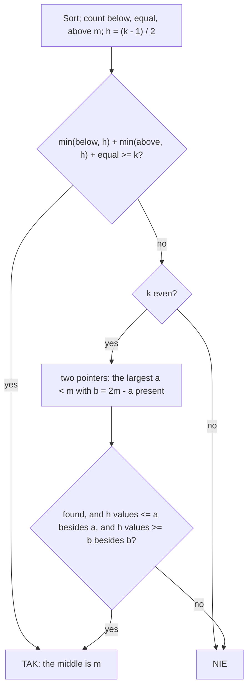

# AMPPZ 2023 D - Data Determination

> [!info] Karta zadania
> - Treść (po angielsku): `202X/2023/D/D.pdf` ([PDF na GitHubie](../../../202X/2023/D/D.pdf)); limit czasu 2 s,
>   pamięć 1024 MB.
> - Technika: sortowanie, zliczanie mniejszych, równych i większych od progu, para o danej sumie dwoma wskaźnikami.
>   Trudność: ~3/5 (szacunek; rankingu 2023 nie znalazłem).
> - Kod: [d-data-determination.cpp](d-data-determination.cpp). Złożoność: O(n log n) na scenariusz.
> - Dzień kursu: [Dzień 6](../../dni/06-matematyka.md), zadanie bez etykiety (technika z Dni 3-5).

## Treść w skrócie

Jest t scenariuszy (t ≤ 10⁴, suma n ≤ 2 · 10⁵). W każdym dane jest n wyników aᵢ (do 10⁹), liczba k ≤ n i wartość m
(do 10⁹). Czy da się wybrać dokładnie k wyników, których mediana wynosi dokładnie m? Mediana parzystej liczby wyników to
średnia dwóch środkowych.

## Zanim przeczytasz dalej

30 minut. Przykład: wyniki 41 43 41 57 41 42, k = 4, m = 42 dają TAK (41, 41, 43, 57: środkowe 41 i 43). Rozpatrz osobno
k nieparzyste i parzyste. Ile wyników mniejszych od m może być wśród wybranych?

> [!tip]- Podpowiedź 1
> Podziel wyniki na trzy grupy: mniejsze od m, równe m, większe od m. Dla nieparzystego k środkowy element musi być
> równy m; ile najwyżej elementów może stać przed nim, a ile po nim?

> [!tip]- Podpowiedź 2
> Dla parzystego k dwa środkowe elementy a ≤ b mają sumę 2m. Albo oba są równe m, albo a < m < b. W drugim przypadku
> które a wybrać, żeby najłatwiej dobrać resztę?

## Droga myślenia

1. **Trzy grupy.** Po posortowaniu: below wyników < m, equal wyników = m, above wyników > m. Niech h = ⌊(k - 1) / 2⌋:
   dla nieparzystego k to indeks środka (od 0), dla parzystego indeks dolnego środka.
2. **Środek równy m.** Wśród wybranych najwyżej h może być mniejszych od m i najwyżej h większych (inaczej środek
   przesunie się poza blok równych m). Reszta to kopie m: dla nieparzystego k co najmniej k - 2h = 1, dla parzystego
   co najmniej 2, czyli oba środki równe m. Da się wtedy i tylko wtedy, gdy min(below, h) + min(above, h) + equal ≥ k
   (warunek sam wymusza potrzebną liczbę kopii m, a nadmiar zawsze można zmniejszyć).
3. **Parzyste k, środki a < m < b.** Wtedy a + b = 2m, a i b są w ciągu, poniżej a trzeba wybrać h wyników ≤ a (poza
   samym a), a powyżej b h wyników ≥ b. Liczba wyników ≤ a rośnie z a, a b = 2m - a maleje, więc liczba wyników ≥ b
   też rośnie. Najlepsze jest więc największe a < m, dla którego 2m - a występuje w ciągu.
4. **Znalezienie pary.** W posortowanej tablicy dwa wskaźniki: i od największego wyniku < m w dół, j od najmniejszego
   wyniku > m w górę. Za mała suma: j w górę; za duża: i w dół. Pierwsza trafiona para ma największe a.



Jak czytać diagram: najpierw sprawdzamy, czy środek (oba środki) może być równy m; to jedyna możliwość dla
nieparzystego k. Dla parzystego k zostaje para różnych środków. Wystarczy sprawdzić jedną, tę z największym a, bo
każda inna para ma mniej kandydatów i z dołu, i z góry.

Przykład 1: below = 3 (41, 41, 41), equal = 1, above = 2, k = 4, h = 1: 1 + 1 + 1 = 3 < 4. Para: a = 41, b = 43 jest.
Wyników ≤ 41 poza samym a: 2 ≥ 1, wyników ≥ 43 poza samym b: 1 ≥ 1. TAK.

## Rozwiązanie

```cpp
bool possible(vector<ll> a, int k, ll m) {
    sort(a.begin(), a.end());
    int n = a.size();
    int below = lower_bound(a.begin(), a.end(), m) - a.begin();
    int equal = upper_bound(a.begin(), a.end(), m) - a.begin() - below;
    int above = n - below - equal;
    int h = (k - 1) / 2;                           // at most h chosen values below the middle and h above it

    // the middle (both middles for even k) equal to m; k - 2h copies of m are forced
    if (min(below, h) + min(above, h) + equal >= k) return true;
    if (k % 2 == 1) return false;

    // even k: middles a < m < b with a + b = 2m; the largest such a is the best one
    int i = below - 1, j = below + equal;
    while (i >= 0 && j < n) {
        ll s = a[i] + a[j];
        if (s < 2 * m) j++;
        else if (s > 2 * m) i--;
        else {
            int le = upper_bound(a.begin(), a.end(), a[i]) - a.begin();       // values <= a
            int ge = n - (lower_bound(a.begin(), a.end(), a[j]) - a.begin());  // values >= b
            return le - 1 >= h && ge - 1 >= h;
        }
    }
    return false;
}
```

Pełny program: [d-data-determination.cpp](d-data-determination.cpp).

## Złożoność i optymalność

- Sortowanie O(n log n), reszta O(n) (dwa wskaźniki) i kilka wyszukiwań binarnych. Przy sumie n ≤ 2 · 10⁵ to ułamek
  sekundy.
- Da się bez sortowania w oczekiwanym O(n): trzy grupy liczy jedno przejście, największe a z 2m - a w ciągu znajduje
  zbiór haszujący, a liczby wyników ≤ a i ≥ b drugie przejście. Przy tych limitach to bez znaczenia.
- Omówienia jury dla 2023 nie znalazłem (ani slajdów, ani rozwiązań w sieci), więc poprawność opiera się na dowodzie
  wyżej i teście z brute force.

## Pułapki

- **Przepełnienie:** 2m i a[i] + a[j] sięgają 2 · 10⁹, poza `int`.
- **Parzyste k z jedną kopią m:** jedna kopia m nie wystarcza na środek; potrzebna para a < m < b. Warunek z punktu 2
  sam to wyklucza, bo wymusza k - 2h = 2 kopie.
- **Wybór pary:** "jakakolwiek para o sumie 2m" nie wystarcza; trzeba sprawdzić, czy da się dobrać po h wyników
  z obu stron, a najłatwiej przy największym a.
- **Wiele scenariuszy:** tablice i liczniki od nowa w każdym; nie sortuj z góry wszystkich danych naraz.

## Weryfikacja

- Kompilacja `g++ -std=c++17 -O2 -Wall -Wextra` bez ostrzeżeń, przykład z treści poprawny (TAK, NIE, NIE).
- 1500 wejść po 30 scenariuszy (n od 1 do 9, wartości blisko m, a w co czwartym scenariuszu blisko 10⁹, żeby 2m nie
  mieściło się w `int`) porównanych z brute force, który przegląda wszystkie podzbiory k-elementowe i porównuje dwie
  środkowe wartości z 2m. Wszystkie zgodne (9827 z 45 000 odpowiedzi to TAK).
- Testy maksymalne: jeden scenariusz z n = 2 · 10⁵ (k = n, n - 1, 2, n / 2) i 10⁴ scenariuszy po 20 wyników: 0,07-0,09 s.

## Wspólny mianownik

**Mediana i próg: policz mniejsze, równe i większe.** Pytanie o medianę albo k-ty element zamienia się w liczniki trzech
grup względem progu i warunek "najwyżej h z każdej strony". Gdy mediana jest średnią dwóch wartości, dochodzi
**para o danej sumie w posortowanej tablicy** (dwa wskaźniki z Dnia 4) i wybór pary skrajnej, która zostawia najwięcej
możliwości. To ten sam ruch co w [2018 J Jednakowe szaliki](../2018/j-jednakowe-szaliki.md): mediana jako punkt,
po którego obu stronach liczy się elementy.
