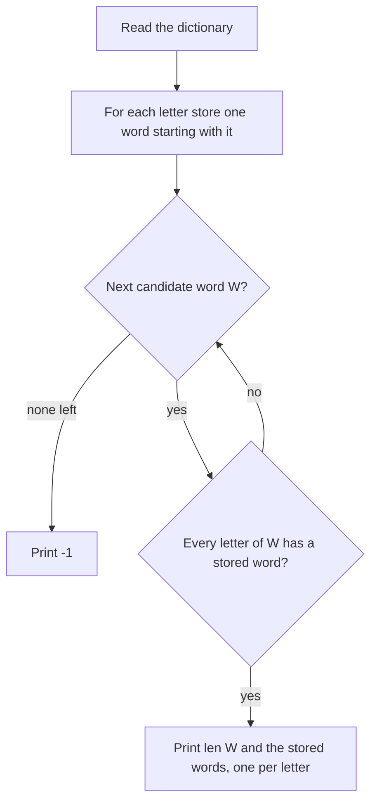

# AMPPZ 2024 A - Akronim

> [!info] Karta zadania
> - Treść: `202X/2024/A/A.pdf` ([PDF na GitHubie](../../../202X/2024/A/A.pdf)); limit czasu 2 s, pamięć 1024 MB.
> - Technika: implementacja, przeformułowanie warunku. Trudność: 1/5 (trywialne).
> - Kod: [a-akronim.cpp](a-akronim.cpp). Złożoność: O(n · L), L ≤ 8.
> - Dzień kursu: [Dzień 1](../../dni/01-start.md).

## Treść w skrócie

Dany jest słownik n różnych słów (n ≤ 200, każde ma 2-8 wielkich liter). Trzeba ułożyć zdanie, czyli ciąg słów
ze słownika (słowa mogą się powtarzać), którego pierwsze litery, sklejone, dają słowo, które też jest
w słowniku. Wypisz liczbę słów i zdanie albo `-1`, gdy się nie da.

## Zanim przeczytasz dalej

Daj sobie 15 minut. Przeczytaj najpierw sekcje Wejście i Wyjście, potem przykłady, a dopiero potem historię
o imieninach. Zapisz jednym zdaniem, czego naprawdę szukasz.

> [!tip]- Podpowiedź 1
> Ile słów ma zdanie, którego akronimem jest słowo W? Od czego musi się zaczynać i-te słowo?

> [!tip]- Podpowiedź 2
> Słowa mogą się powtarzać, więc dla i-tej litery W wystarczy jakiekolwiek słowo zaczynające się na tę literę.
> Kiedy takie zdanie dla danego W istnieje?

## Droga myślenia

1. **Przeformułuj.** Jeśli akronimem zdania ma być słowo W, to zdanie ma dokładnie |W| słów, a i-te słowo
   zaczyna się na i-tą literę W. Nic więcej treść nie wymaga: słowa mogą się powtarzać, a samo W też może
   być w zdaniu.
2. **Warunek istnienia.** Dla ustalonego W zdanie istnieje wtedy i tylko wtedy, gdy każda litera W jest
   pierwszą literą jakiegoś słowa ze słownika. Historia o życzeniach zamieniła się w jeden prosty warunek.
3. **Limity.** n ≤ 200 i słowa do 8 liter, więc nawet sprawdzenie "dla każdego W, dla każdej jego litery,
   przejrzyj cały słownik" to 200 · 8 · 200 = 320 000 operacji. Każde rozwiązanie wielomianowe się zmieści.
4. **Ładniej.** Raz przejdź po słowniku i dla każdej z 26 liter zapamiętaj jedno słowo, które się na nią
   zaczyna. Potem sprawdzenie W to |W| zajrzeń do tablicy.
5. **Przykłady jako test pomysłu.** Drugi przykład (słownik `XX`) pokazuje, że słowo może być akronimem samego
   siebie: zdanie `XX XX`. Nasz warunek to obejmuje (litera X zaczyna słowo XX).



Jak czytać diagram: najpierw jeden przebieg po słowniku buduje tablicę "litera → słowo". Potem pętla po
kandydatach na akronim: dla każdego W sprawdzamy, czy każda jego litera ma słowo w tablicy. Pierwszy W, który
przejdzie test, kończy program wypisaniem zdania; jeśli żaden nie przejdzie, wypisujemy -1.

## Rozwiązanie

```cpp
vector<string> starts(26, "");                 // starts[c] = some word beginning with letter c
for (const auto& w : words)
    if (starts[w[0] - 'A'].empty()) starts[w[0] - 'A'] = w;

for (const auto& acronym : words) {            // try every word as the acronym
    bool ok = true;
    for (char c : acronym)
        if (starts[c - 'A'].empty()) { ok = false; break; }
    if (!ok) continue;
    cout << acronym.size() << "\n";            // number of words first
    for (size_t i = 0; i < acronym.size(); i++)
        cout << starts[acronym[i] - 'A'] << (i + 1 < acronym.size() ? ' ' : '\n');
    return 0;
}
cout << -1 << "\n";
```

Pełny program: [a-akronim.cpp](a-akronim.cpp).

## Złożoność i optymalność

Budowa tablicy O(n), sprawdzenie wszystkich kandydatów O(n · L), wypisanie O(L) słów. Samo wczytanie wejścia
kosztuje O(n · L), więc szybciej się nie da: rozwiązanie jest optymalne.

## Pułapki

- **Format wyjścia.** Najpierw liczba słów, potem zdanie. W repo leży `202X/2024/A/badsolution.cpp`, który od
  poprawnego `goodsolution.cpp` różni się jedną zakomentowaną linijką: brak liczby słów. Taki błąd daje
  "Wrong Answer" mimo dobrego pomysłu.
- **Wiele poprawnych odpowiedzi.** Treść mówi "wypisz dowolne", więc Twoje wyjście nie musi być identyczne
  z przykładem. Nasz program dla pierwszego przykładu wypisuje `ANIA NA IMIENINY ANIA`, które treść wprost
  podaje jako poprawne.

## Weryfikacja

- Kompilacja `g++ -std=c++17 -O2 -Wall -Wextra` bez ostrzeżeń; oba przykłady z treści poprawne.
- 1500 testów losowych (małe słowniki nad alfabetem 2-5 liter, żeby często zdarzało się -1): odpowiedź `-1`
  albo nie zgadza się z rozwiązaniem właściciela repo (`goodsolution.cpp`), a każde wypisane zdanie sprawdza
  osobny program (słowa ze słownika, akronim w słowniku).
- Porównanie ze źródłami: oficjalnego omówienia AMPPZ 2024 nie znalazłem (research z 2026-11-07); zadanie jest na
  sędzi QOJ (https://qoj.ac/category/194, wymaga konta). Optymalność wynika z dolnego ograniczenia na czytanie wejścia.

## Wspólny mianownik

**Historia ukrywa prosty warunek.** W zadaniach trywialnych prawie zawsze pierwszym krokiem jest
przeformułowanie: "czego dokładnie potrzebuję, żeby odpowiedź istniała?". Zapisz to jednym zdaniem,
zanim napiszesz kod. Drugi wzór z tego zadania: **dowolna poprawna odpowiedź** oznacza, że wolno wybrać
najprostszą konstrukcję (tu: pierwsze słowo na każdą literę).
