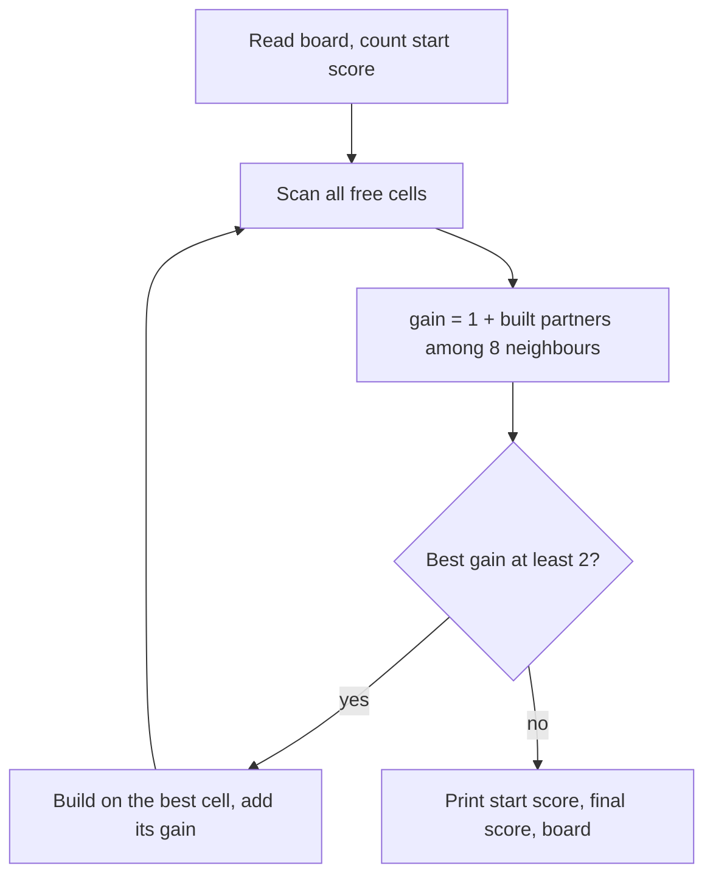

# AMPPZ 2024 G - Gra MPO

> [!info] Karta zadania
> - Treść: `202X/2024/G/G.pdf` ([PDF na GitHubie](../../../202X/2024/G/G.pdf)); limit czasu 2 s, pamięć 1024 MB.
> - Technika: symulacja na planszy, sąsiedzi w 8 kierunkach. Trudność: 2/5 (łatwe; liczby drużyn z rankingu 2024
>   jeszcze nie mam).
> - Kod: [g-gra-mpo.cpp](g-gra-mpo.cpp) (symulacja wprost, O(n⁴)) i [g-gra-mpo-kolejka.cpp](g-gra-mpo-kolejka.cpp)
>   (wersja optymalna, O(n²)).
> - Dzień kursu: [Dzień 2](../../dni/02-stl-symulacja.md).

## Treść w skrócie

Plansza n × n (2 ≤ n ≤ 10). Pola `M`, `P`, `O` to zbudowane miasto, park i ocean; `m`, `p`, `o` to puste pola, na
których można zbudować to samo wielką literą; `.` to pole, na którym nic się nie zbuduje. Punkt dostajesz za każdą
strukturę i za każdą parę stykających się (bokiem lub rogiem) struktur miasto-park oraz ocean-ocean. Ruch zamienia
małą literę na wielką; ruch dający dokładnie 1 punkt jest zakazany. Zawsze wykonujesz ruch z największym zyskiem,
aż nie zostanie ruch za co najmniej 2 punkty. Wypisz punkty na początku i na końcu oraz końcową planszę.

## Zanim przeczytasz dalej

20 minut. Przelicz przykład z treści na kartce: ile punktów daje każdy możliwy ruch na początkowej planszy?

> [!tip]- Podpowiedź 1
> Ile punktów daje zbudowanie miasta na polu `m`? Jeden za samo miasto i po jednym za każdy zbudowany park wśród
> ośmiu sąsiadów. Kiedy więc ruch jest zakazany?

> [!tip]- Podpowiedź 2
> n ≤ 10, czyli najwyżej 100 pól. Ile ruchów może być najwięcej i ile kosztuje znalezienie najlepszego ruchu? Czy
> trzeba tu czegokolwiek sprytnego?

## Droga myślenia

1. **Zysk ruchu.** Budując strukturę S, dostajesz 1 punkt za nią i po punkcie za każdego zbudowanego sąsiada, który
   tworzy z S parę: dla miasta to parki, dla parku miasta, dla oceanu oceany. Zysk = 1 + liczba takich sąsiadów.
   Ruch jest zakazany dokładnie wtedy, gdy nie ma ani jednego takiego sąsiada.
2. **Limity.** Pól jest najwyżej 100, więc ruchów najwyżej 100. Znalezienie najlepszego ruchu to przejrzenie 100 pól
   po 8 sąsiadów. Razem ok. 100 · 100 · 8 = 80 000 operacji, czyli nic. Symulujemy dokładnie to, co mówi treść.
3. **Punkty planszy** (potrzebne na początku): każda struktura daje 1, a każdą parę trzeba policzyć raz. Pary
   miasto-park liczymy tylko od strony miasta (każda taka para ma dokładnie jedno miasto). Parę ocean-ocean widać
   z obu oceanów, więc ich licznik dzielimy przez 2.
4. **Wynik końcowy** to punkty początkowe plus suma zysków wykonanych ruchów. Przeliczenie końcowej planszy od zera
   daje to samo i jest dobrym sprawdzeniem.



Jak czytać diagram: pętla B, C, D, E to jeden ruch gry. Każdy obieg buduje jedną strukturę, więc pętla wykona się
najwyżej n² razy. Kończy ją jedyny warunek z treści: brak ruchu za co najmniej 2 punkty.

## Rozwiązanie

```cpp
// built neighbours of (r, c) that pair with structure s
int pairsAround(int r, int c, char s) {
    int cnt = 0;
    for (int d = 0; d < 8; d++) {
        int nr = r + dr[d], nc = c + dc[d];
        if (inside(nr, nc) && board[nr][nc] == partner(s)) cnt++;
    }
    return cnt;
}

// main loop: one move per iteration
while (true) {
    int bestGain = 0, br = -1, bc = -1;
    for (int r = 0; r < n; r++)
        for (int c = 0; c < n; c++) {
            char s = board[r][c];
            if (s != 'm' && s != 'p' && s != 'o') continue;
            int gain = 1 + pairsAround(r, c, toupper(s));
            if (gain > bestGain) bestGain = gain, br = r, bc = c;
        }
    if (bestGain < 2) break;                           // only +1 moves left, they are forbidden
    board[br][bc] = toupper(board[br][bc]);
    total += bestGain;
}
```

Pełny program: [g-gra-mpo.cpp](g-gra-mpo.cpp). Tablice `dr` i `dc` to 8 przesunięć do sąsiadów, a `partner` zwraca
strukturę, która tworzy parę z daną (sekcja o symulacji w [Dniu 2](../../dni/02-stl-symulacja.md)).

## Złożoność i optymalność

- **Symulacja wprost:** najwyżej n² ruchów, każdy przegląda n² pól po 8 sąsiadów: O(n⁴), dla n = 10 ok. 80 000
  operacji. Na zawodach to właściwy wybór: n jest malutkie, a kod prosty.
- **Rozwiązanie optymalne, O(n²).** Obserwacja: zysk pola nigdy nie maleje, bo struktury tylko się dokłada. Pole,
  które raz stało się dozwolone, zostaje dozwolone do końca. Stąd końcowa plansza nie zależy od kolejności ruchów
  (treść to zapowiada, ale nie dowodzi).
  - Dowód w skrócie: weź dwie dowolne rozgrywki doprowadzone do końca, A i B. Pierwsze pole zbudowane w A ma
    partnera wśród struktur początkowych, więc na końcu B też daje co najmniej 2 punkty; B się skończyła, więc musiała
    je zbudować. Każde następne pole A ma partnera wśród struktur początkowych albo wcześniejszych pól A, a te
    (indukcja) są zbudowane w B. Zatem każde pole zbudowane w A jest zbudowane w B, i symetrycznie.
  - Wystarczy więc budować cokolwiek dozwolonego, aż nic nie zostanie. Robimy to jak przeszukiwanie wszerz: kolejka
    pól zbudowanych, a po zbudowaniu pola sprawdzamy tylko jego 8 sąsiadów. Każde pole budujemy raz, więc O(n²)
    ([g-gra-mpo-kolejka.cpp](g-gra-mpo-kolejka.cpp)). Lepiej się nie da, bo samo wczytanie planszy to n².
- Reguła "zawsze największy zysk" jest więc zasłoną: zmienia tylko kolejność ruchów, a nie wynik.

## Pułapki

- **Styk rogiem też się liczy:** 8 sąsiadów, nie 4.
- **Pary liczone raz:** ocean-ocean widać z obu stron (dziel przez 2), miasto-park licz tylko od strony miasta.
- **Wynik początkowy** zawiera też pary między strukturami, które już stoją na planszy.
- **Brzeg planszy:** `inside(nr, nc)` sprawdzaj przed odczytem `board[nr][nc]`; poza tablicą jest śmieć albo
  wywrotka programu.
- `toupper` zwraca `int`; przypisanie wyniku do pola typu `char` jest w porządku.

## Weryfikacja

- Kompilacja `g++ -std=c++17 -O2 -Wall -Wextra` bez ostrzeżeń, przykład z treści poprawny w obu wersjach.
- 1500 testów losowych (n od 2 do 10; trzy generatory: dowolne pola; prawie same wolne pola z kilkoma zbudowanymi,
  żeby powstawały długie łańcuchy ruchów; same oceany i miasta) porównanych z rozwiązaniem siłowym, które po każdym
  możliwym ruchu przelicza punkty całej planszy od zera i remisy rozstrzyga losowo. Obie wersje zgodne we wszystkich
  testach, co potwierdza też zdanie z treści, że sposób rozstrzygania remisów nie zmienia wyniku.
- Porównanie ze źródłami: oficjalnego omówienia AMPPZ 2024 jeszcze nie znalazłem. Zadanie jest na sędzi QOJ
  w kategorii AMPPZ (https://qoj.ac/category/194, wymaga konta). Rozwiązanie O(n²) jest optymalne z argumentu
  o wczytaniu danych.

## Wspólny mianownik

**Symulacja przy małych limitach.** Wykonaj proces dosłownie, krok po kroku, i policz tylko iloczyn: liczba kroków
× koszt kroku. Sprytu szukaj dopiero wtedy, gdy ten iloczyn przekracza budżet. Drugi wzorzec: **proces
monotoniczny** (rzeczy tylko się dokłada, nic nie znika) zwykle kończy się tym samym stanem przy każdej kolejności;
wtedy liczysz domknięcie kolejką zamiast symulować wybór ruchu.
