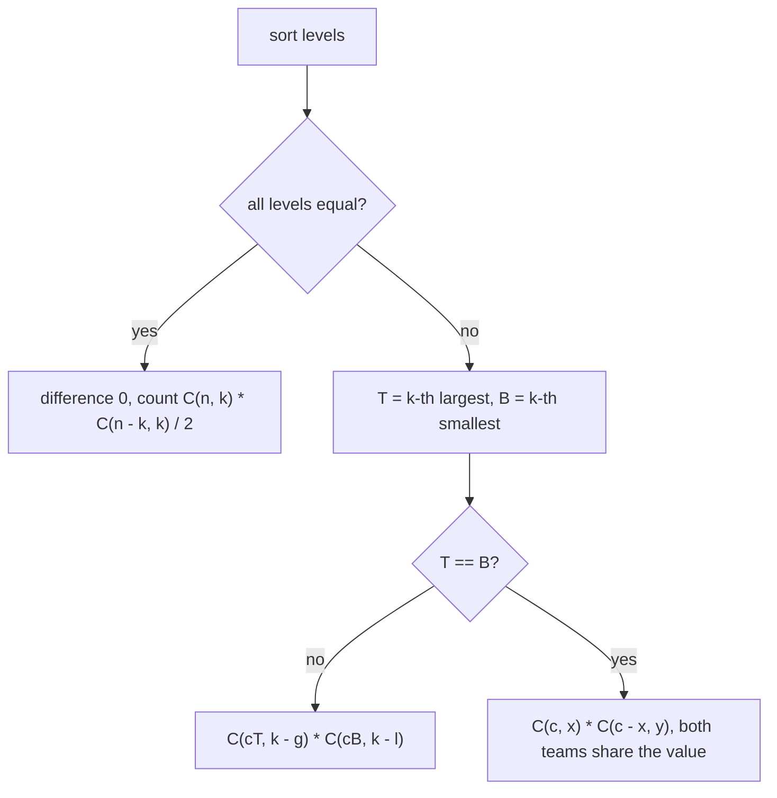

# AMPPZ 2024 I - Intensywny trening

> [!info] Karta zadania
> - Treść: `202X/2024/I/I.pdf` ([PDF na GitHubie](../../../202X/2024/I/I.pdf)); czas 4 s, pamięć 1024 MB.
> - Technika: sortowanie i zachłanne (k największych przeciw k najmniejszym), potem zliczanie dwumianami modulo
>   10⁹ + 7. Trudność: ~3 (rankingu 2024 brak, szacunek z treści).
> - Kod: [i-intensywny-trening.cpp](i-intensywny-trening.cpp). Złożoność: O(n log n).
> - Dzień kursu: [Dzień 10](../../dni/10-dp-1.md), zadanie bez etykiety (techniki z
>   [Dnia 3](../../dni/03-sortowanie-zachlanne.md) i [Dnia 6](../../dni/06-matematyka.md)).

## Treść w skrócie

Jest n ≤ 2000 zawodników o poziomach a_i ≤ 10⁶. Mecz to dwie rozłączne drużyny po k zawodników (2k ≤ n), poziom
drużyny to suma poziomów. Znajdź największą możliwą różnicę poziomów drużyn w meczu i policz modulo 10⁹ + 7 mecze,
które ją osiągają; mecz to nieuporządkowana para drużyn (A przeciw B to ten sam mecz co B przeciw A).

## Zanim przeczytasz dalej

30 minut. Przykłady z treści: n = 6, k = 2, poziomy `2 5 7 2 5 2` dają `8 6`; n = 5, k = 2, same jedynki dają `0 15`.

> [!tip]- Podpowiedź 1
> Która drużyna ma największą sumę, a która najmniejszą? Posortuj. Potem zastanów się, których zawodników da się
> zamienić bez zmiany sum.

> [!tip]- Podpowiedź 2
> Silniejsza drużyna zawiera wszystkich zawodników ostro lepszych od k-tego największego poziomu T i kilku z poziomem
> równym T. Wybór "których kilku" to dwumian. Uważaj, gdy wszyscy mają ten sam poziom: wtedy drużyny są
> nierozróżnialne.

## Droga myślenia

1. **Maksimum.** Różnica to suma jednej drużyny minus suma drugiej, a obie mają po k osób. Największa możliwa suma k
   osób to k największych, najmniejsza to k najmniejszych, a przy 2k ≤ n te zbiory po posortowaniu się nie nakładają.
   Wynik: suma k największych minus suma k najmniejszych.
2. **Które drużyny osiągają maksimum.** Silniejsza drużyna musi mieć sumę równą sumie k największych. Niech T to k-ty
   największy poziom, g to liczba zawodników z poziomem większym niż T, c_T to liczba z poziomem T. Drużyna musi wziąć
   wszystkich g i dokładnie k - g spośród c_T: C(c_T, k - g) sposobów. Symetrycznie słabsza: B to k-ty najmniejszy
   poziom, l zawodników poniżej B, c_B równych B, C(c_B, k - l) sposobów.
3. **Wspólna granica.** Jeśli T > B, wybory są niezależne i wynik to iloczyn. Jeśli T = B (ale nie wszyscy są równi),
   obie drużyny biorą z tej samej grupy c zawodników o poziomie T: najpierw x = k - g dla silniejszej, potem y = k - l
   z pozostałych, C(c, x) · C(c - x, y). Miejsca starczy, bo g + c + l = n ≥ 2k.
4. **Wszyscy równi.** Różnica 0 i każdy mecz jest optymalny: C(n, k) · C(n - k, k) uporządkowanych par, a mecz jest
   parą nieuporządkowaną, więc dzielimy przez 2 (mnożenie przez odwrotność 2 modulo 10⁹ + 7). Gdy różnica jest
   dodatnia, silniejsza drużyna jest wyznaczona jednoznacznie i nic nie liczy się dwa razy. Różnica jest zerem tylko
   wtedy, gdy wszyscy są równi: k największych o sumie równej k najmniejszym oznacza minimum równe maksimum.



Jak czytać diagram: po sortowaniu swoboda jest tylko na granicach: wśród zawodników równych k-temu największemu
i k-temu najmniejszemu poziomowi. Trzy liście drzewa to trzy wzory na liczbę meczów.

Pierwszy przykład: po sortowaniu `2 2 2 5 5 7`. Silniejsza: 7 i jedna z dwóch piątek (C(2, 1) = 2), suma 12. Słabsza:
dwie z trzech dwójek (C(3, 2) = 3), suma 4. Różnica 8, mecze 2 · 3 = 6.

## Rozwiązanie

```cpp
sort(a.begin(), a.end());
long long diff = 0;
for (int i = 0; i < k; i++) diff += a[n - 1 - i] - a[i];
long long ways;
if (a[0] == a[n - 1]) {
    ways = C(n, k) * C(n - k, k) % MOD * power(2, MOD - 2) % MOD;   // unordered pair of teams
} else {
    long long top = a[n - k], bot = a[k - 1];
    int greater = a.end() - upper_bound(a.begin(), a.end(), top);
    int cntTop = upper_bound(a.begin(), a.end(), top) - lower_bound(a.begin(), a.end(), top);
    int smaller = lower_bound(a.begin(), a.end(), bot) - a.begin();
    int cntBot = upper_bound(a.begin(), a.end(), bot) - lower_bound(a.begin(), a.end(), bot);
    int x = k - greater, y = k - smaller;
    if (top != bot) ways = C(cntTop, x) * C(cntBot, y) % MOD;
    else ways = C(cntTop, x) * C(cntTop - x, y) % MOD;
}
```

Pełny program: [i-intensywny-trening.cpp](i-intensywny-trening.cpp) (silnie i odwrotności silni do n, jak w Dniu 6).

## Złożoność i optymalność

- O(n log n) na sortowanie, O(n) na silnie; przy n ≤ 2000 to ułamek milisekundy. Limit n ≤ 2000 dopuszcza nawet
  trójkąt Pascala O(n²), więc jury nie wymagało niczego szybszego.
- Omówienia zadań 2024 nie znaleziono; poprawność wynika z argumentu wymiany (kroki 1-2) i rozbicia na przypadki
  (kroki 3-4), sprawdzonego brute force na wszystkich podziałach.

## Pułapki

- **Dzielenie przez 2 zawsze albo nigdy:** tylko przy różnicy 0 drużyny są zamienne. Przy różnicy dodatniej podział
  przez 2 daje zły wynik.
- **T = B przy różnych poziomach:** na przykład `1 2 2 3`, k = 2: obie drużyny potrzebują jednej dwójki, wynik
  C(2, 1) · C(1, 1) = 2, a nie C(2, 1) · C(2, 1) = 4.
- **Dzielenie modulo:** dzielenie przez 2 to mnożenie przez odwrotność (500000004), nie `/ 2` na reszcie.
- **Zakres:** różnica do 1000 · 10⁶ = 10⁹ mieści się w `int` na styk; `long long` na wszelki wypadek.

## Weryfikacja

- Kompilacja `g++ -std=c++17 -O2 -Wall -Wextra` bez ostrzeżeń, przykłady z treści dają `8 6` i `0 15`.
- 1500 wejść losowych (n od 2 do 9, k do n / 2, poziomy z zakresu 1, 1..2, 1..3, 1..5 albo 1..10⁶, więc dużo remisów
  na granicach) porównanych z brute force, który przypisuje każdego zawodnika do drużyny A, drużyny B albo poza mecz
  (3ⁿ możliwości) i dzieli liczbę par uporządkowanych przez 2. W 360 wejściach wszyscy mieli ten sam poziom
  (różnica 0). Wszystkie zgodne.
- Testy maksymalne, n = 2000, k = 1000: poziomy 1..3 0,02 s; wszyscy równi 0,01 s.

## Wspólny mianownik

**Zliczanie optymalnych rozwiązań: najpierw kształt optimum, potem swoboda tylko na granicy.** Po sortowaniu
optymalny wybór jest wyznaczony poza remisami na progu; liczba rozwiązań to dwumiany po grupach równych wartości na
granicy, z osobnym przypadkiem, gdy granice się stykają albo obiekty stają się nierozróżnialne.
