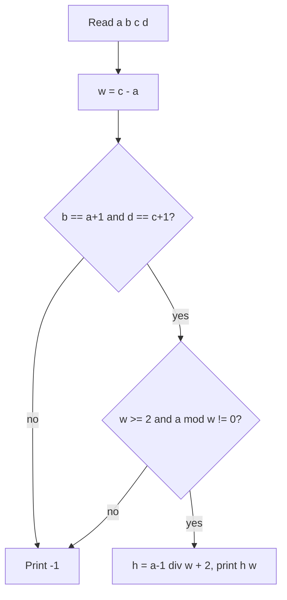

# AMPPZ 2024 K - Kwadracik

> [!info] Karta zadania
> - Treść: `202X/2024/K/K.pdf` ([PDF na GitHubie](../../../202X/2024/K/K.pdf)); limit czasu 3 s, pamięć 1024 MB.
> - Technika: matematyka na indeksach, sprawdzanie warunków. Trudność: 1/5 (trywialne z pułapką).
> - Kod: [k-kwadracik.cpp](k-kwadracik.cpp). Złożoność: O(1) na przypadek testowy.
> - Dzień kursu: [Dzień 1](../../dni/01-start.md).

## Treść w skrócie

Liczby od 1 do h · w zapisano wierszami w tablicy o h wierszach i w kolumnach (h, w ≥ 2). Zostawiono tylko
jeden kwadrat 2 × 2 sąsiednich liczb. Dla danego kwadratu (dwa wiersze po dwie liczby, każda do 50 000) znajdź
dowolne pasujące h i w (2 ≤ h, w ≤ 100 000) albo wypisz `-1`. Do 10 przypadków testowych.

## Zanim przeczytasz dalej

15 minut. Narysuj tablicę 3 × 4 z treści i zastanów się, jak w niej wyglądają sąsiedzi liczby x: po prawej,
pod spodem, po skosie.

> [!tip]- Podpowiedź 1
> W tablicy o szerokości w sąsiad z prawej to x + 1, a sąsiad pod spodem to x + w. Co to mówi o kwadracie
> [[a, b], [c, d]]?

> [!tip]- Podpowiedź 2
> Szerokość w jest wyznaczona jednoznacznie. Spójrz na drugi przykład, `[[2, 3], [4, 5]]`: wszystkie równości
> z podpowiedzi 1 są spełnione dla w = 2, a odpowiedź to -1. Dlaczego?

## Droga myślenia

1. **Rysunek.** W tablicy o szerokości w liczba x ma sąsiada z prawej x + 1 (o ile x nie stoi w ostatniej
   kolumnie) i sąsiada pod spodem x + w.
2. **Warunki.** Kwadrat [[a, b], [c, d]] musi spełniać: b = a + 1, c = a + w, d = c + 1. Z drugiej równości
   w = c - a, czyli szerokość jest wyznaczona jednoznacznie. Treść wymaga w ≥ 2.
3. **Ukryty warunek (pułapka).** Równość b = a + 1 nie wystarczy: jeśli a stoi w ostatniej kolumnie, to a + 1
   jest na początku następnego wiersza i nie leży obok a. Liczba a stoi w ostatniej kolumnie dokładnie wtedy,
   gdy a jest podzielne przez w. Drugi przykład to właśnie ten przypadek: a = 2, w = 2.
4. **Wysokość.** Liczba a leży w wierszu (a - 1) / w + 1 (dzielenie całkowite). Pod nim musi być jeszcze jeden
   wiersz, więc najmniejsze dobre h = (a - 1) / w + 2. Każde większe h też jest dobre, ale wystarczy jedno.
5. **Zakresy.** a ≤ 50 000 i w ≥ 2, więc h ≤ 25 001, a w < 50 000: mieści się w wymaganych 100 000.



Jak czytać diagram: szerokość bierzemy z różnicy liczb w kolumnie. Potem dwa testy: czy liczby w wierszach są
kolejne i czy kwadrat nie "zawija się" przez koniec wiersza (a w ostatniej kolumnie). Gdy oba przejdą,
wysokość to numer wiersza liczby a plus jeden wiersz poniżej.

## Rozwiązanie

```cpp
long long w = c - a;                                  // c lies directly below a
if (b == a + 1 && d == c + 1 && w >= 2 && a % w != 0) {
    long long h = (a - 1) / w + 2;                    // row of a, plus the row below it
    cout << h << " " << w << "\n";
} else {
    cout << -1 << "\n";
}
```

Pełny program: [k-kwadracik.cpp](k-kwadracik.cpp). Dla czwartego przykładu wypisuje `2 4` zamiast `3 4` z treści:
obie odpowiedzi są poprawne (tablica 2 × 4 też zawiera [[1, 2], [5, 6]]).

## Złożoność i optymalność

O(1) na przypadek testowy: kilka porównań i jedno dzielenie. Lepiej się nie da.

## Pułapki

- **Zawijanie wiersza** (a w ostatniej kolumnie): jedyna nieoczywista rzecz w zadaniu, ukryta w przykładzie
  z odpowiedzią -1.
- **w ≥ 2**: gdy c - a = 1 albo c ≤ a, odpowiedź to -1; bez tego warunku `a % w` przy w = 0 wywaliłoby program
  (dzielenie przez zero). Kolejność warunków w `if` ma znaczenie: `w >= 2` stoi przed `a % w`.
- **Dowolna odpowiedź**: nie próbuj odtworzyć `3 4` z przykładu.

## Weryfikacja

- Kompilacja bez ostrzeżeń, przykład z treści poprawny (z dozwoloną inną odpowiedzią w czwartym przypadku).
- 4000 testów losowych porównanych z rozwiązaniem siłowym: zbiór wszystkich kwadratów 2 × 2 ze wszystkich tablic
  do 60 × 40; połowa testów to prawdziwe kwadraty (także z a w ostatniej kolumnie i z lekko zepsutymi liczbami),
  połowa to losowe czwórki. Każda wypisana para (h, w) sprawdzona osobno.
- Wartości graniczne: `49999 50000 / 50001 50002` daje `25001 2`, `1 2 / 50000 50001` daje `2 49999`.
- Porównanie ze źródłami: oficjalnego omówienia AMPPZ 2024 nie znalazłem (research z 2026-11-07); zadanie jest na
  sędzi QOJ (https://qoj.ac/category/194, wymaga konta). Rozwiązanie O(1) jest optymalne.

## Wspólny mianownik

**Zadanie na warunki.** Zapisz wszystkie warunki, które definiują obiekt (tu: kwadrat w tablicy), i sprawdź
każdy. Pułapką jest prawie zawsze warunek "oczywisty", którego nie zapisałeś (tu: nie przechodzimy przez koniec
wiersza). Reguła do dziennika: **przykład z odpowiedzią -1 rozbierz na części: dlaczego tu się nie da?**
Autorzy często wkładają tam właśnie pułapkę.
